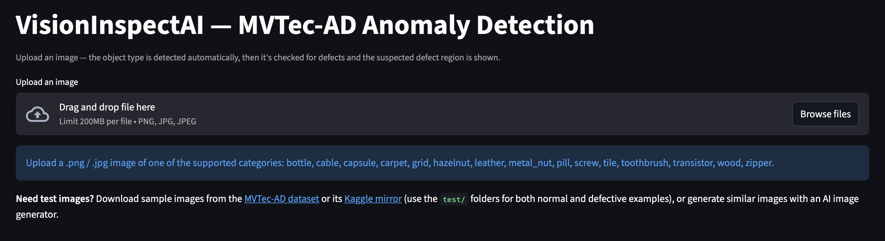
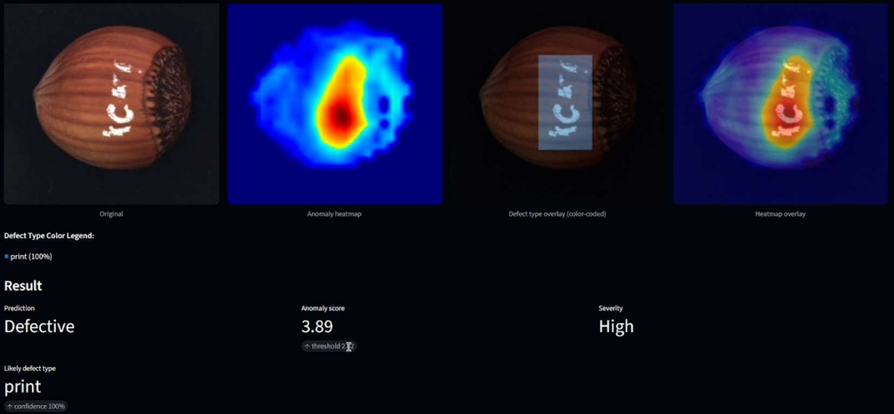

## SECTION 1 : PROJECT TITLE
## VisionInspectAI — Industrial Defect Inspection with Pattern Recognition



---

## SECTION 2 : EXECUTIVE SUMMARY / PAPER ABSTRACT

Inspecting manufactured products for defects is still largely done by eye, which is inconsistent between inspectors, hard to scale and tiring over a long shift. Automating it is difficult because defects are rare and take many forms, so labeled examples of every defect a factory might meet are seldom available.

**VisionInspectAI** is an AI-powered inspection system that takes a single product photo and answers four questions: which product it is, whether it is defective, where the suspected defect lies, and which known defect type best describes it. It covers all 15 categories of the MVTec AD benchmark and is delivered as an interactive Streamlit web app that returns the verdict, an anomaly score, a heatmap overlay, a severity level and the likely defect type.

The solution is a hybrid pipeline combining supervised and unsupervised learning. The system first recognises the product category and routes the image to that category's models. A detector trained only on normal images then decides whether the product is Normal or Defective and highlights the suspected defect, and defective images are passed to classifiers that name the defect type.

All data comes from the public MVTec AD dataset. The system recognised the product category correctly on every one of the 1,725 test images, detected defects with a mean ROC-AUC of 0.968 across the 15 categories, and named the defect type correctly for about 91% of the validation images.

These results hold within MVTec's controlled capture conditions and need independent production-like images before any deployment claim. The app can also be tried with AI-generated images that resemble the 15 categories. The full methods, per-category results and discussion are in the project report.

---

## SECTION 3 : CREDITS / PROJECT CONTRIBUTION

| Official Full Name | Student ID (MTech Applicable) | Email |
| :------------ | :---------------: | :----- |
| Loh Kian Chee | A0339775J | kian.chee.loh@u.nus.edu |
| Sim Yee Fei | A0339751W | yee-fei.sim@u.nus.edu |

---

## SECTION 4 : VIDEO OF SYSTEM MODELLING & USE CASE DEMO

[](https://www.youtube.com/watch?v=cVghZcQc1hc "VisionInspectAI")

---

## SECTION 5 : USER GUIDE

### What you need

- Python 3.10 or newer
- An internet connection and about 2 GB of free disk space (one-time download of the trained models)

### Step 1: Install

The code lives in the [SystemCode](SystemCode) folder; run all commands from there.

```bash
git clone https://github.com/YeeFei93/VisionInspectAI
cd VisionInspectAI/SystemCode
python3 -m venv .venv
source .venv/bin/activate        # Windows: .venv\Scripts\activate
pip install -r requirements.txt
```

### Step 2: Download the trained models (once)

```bash
python scripts/download_models.py
```

### Step 3: Start the app

```bash
streamlit run app/streamlit_app.py
```

Your browser opens the VisionInspectAI page (if it doesn't, open the address shown in the terminal, usually http://localhost:8501).

### Step 4: Inspect an image

1. Click **Upload an image** and choose a `.png`, `.jpg` or `.jpeg` photo of one of the supported products: `bottle`, `cable`, `capsule`, `carpet`, `grid`, `hazelnut`, `leather`, `metal_nut`, `pill`, `screw`, `tile`, `toothbrush`, `transistor`, `wood` or `zipper`.
2. The product type is detected automatically. If it is wrong, open **Override automatic category detection** and pick the category yourself.
3. Read the result:

| What you see | Meaning |
|---|---|
| **Detected category** | The product type and how confident the app is |
| **Original / Anomaly heatmap / Heatmap overlay** | The image, where it looks unusual (red = most unusual), and the two combined |
| **Defect type overlay** | Defective images only: the suspected defect regions, colour-coded by defect type |
| **Prediction** | **Normal** or **Defective** |
| **Anomaly score** | How unusual the image is, shown next to the decision threshold (a score at or above the threshold is Defective; it is a distance, not a probability) |
| **Severity** | **Low**, **Medium** or **High**, based on how much of the product the defect covers |
| **Likely defect type** | For defective images, the most likely kind of defect (for example `print` on a hazelnut) and its confidence |

### Good to know

- If the category confidence is below 60%, no prediction is shown; try another image or choose the category manually. Between 60% and 70% a warning asks you to double-check the category.
- Photos that differ a lot from the training images (different background, lighting or camera, or a product that isn't one of the 15 above) can give unreliable results.
- The highlighted region is an approximation of where the defect is, not a pixel-exact outline.
- **Need test images?** Use the `test/` folders of [MVTec AD](https://www.mvtec.com/research-teaching/datasets/mvtec-ad) or its [Kaggle mirror](https://www.kaggle.com/datasets/ipythonx/mvtec-ad), which contain both normal and defective examples, or generate similar images with an AI image generator.

---

## SECTION 6 : PROJECT REPORT / PAPER

`Refer to` [ProjectReport](ProjectReport) `in Github Folder: ProjectReport`

`<File Link>` : [ISY5002-PRS-PM-PT_GRP19-VisionInspectAI-FinalReport.docx](ProjectReport/ISY5002-PRS-PM-PT_GRP19-VisionInspectAI-FinalReport.docx)

**Sections in the Project Report / Paper:**
- Project Overview and Data
- Tools and Techniques Used
- System Design and Model Architecture
- Inspection Outputs and Deployment Choices
- System Performance and Evaluation
- Category and Defect Classification Results
- Comparative Experiments and Fusion
- Findings from Model and Localization Studies
- Discussion and Limitations
- Conclusion
- References

---

## SECTION 7 : MISCELLANEOUS

`Refer to Github Folder: Miscellaneous`

- VisionInspectAI.png
- video-thumbnail.png
