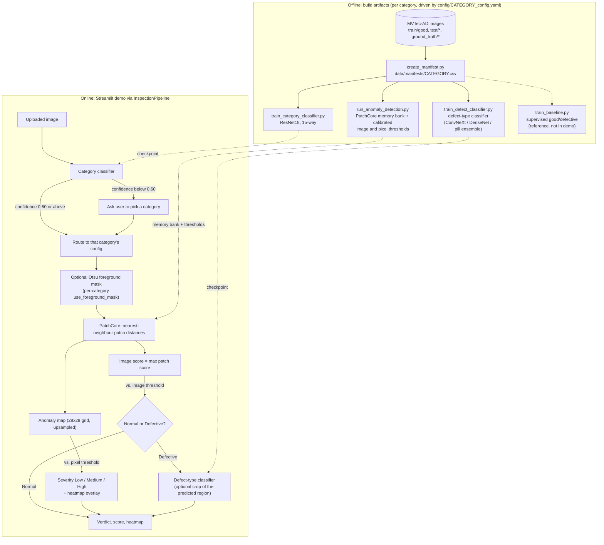

# VisionInspectAI
Use MVTec-AD categories to detect whether an image is normal or defective, and show the defect location using a heatmap. Currently configured and routed through the Streamlit demo for all 15 categories: `screw`, `bottle`, `hazelnut`, `carpet`, `leather`, `wood`, `grid`, `tile`, `transistor`, `cable`, `capsule`, `metal_nut`, `pill`, `toothbrush`, and `zipper`.

## Results at a Glance

All numbers below are copied from the detailed sections they link to; see those sections for protocol, caveats and per-category breakdowns.

| Component | Task | Evaluation protocol | Headline result |
|---|---|---|---|
| Category classifier (ResNet18) | Which of the 15 objects is this? (routes the demo) | 1,725 held-out MVTec `test/` images, evaluated once | Accuracy **1.000**, perfect 15×15 confusion matrix ([details](#category-classifier-benchmark--all-15-categories)) |
| PatchCore (unsupervised, ResNet18 `layer2+3`) | Normal vs. defective + defect heatmap | Fit on `train/good` only; thresholds from held-out normals; full MVTec `test/` scored once, all 15 categories | Mean image ROC-AUC **0.968** (0.899 screw → 1.000 bottle/leather), pixel ROC-AUC **0.958**, accuracy 0.899, F1 0.925, mean IoU/Dice 0.151 / 0.235 ([details](#generalization-to-other-categories)) |
| Defect-type classifier (final category-routed: ConvNeXt-Tiny default, DenseNet121 cable, 4-model soft vote pill) | Which kind of defect is it? | Seed-42 stratified 70/30 split, 14 categories with subtype labels (373 images) | Mean accuracy **0.913 ± 0.072** (338/373 pooled) vs. 0.659 for the no-augmentation ResNet18 baseline; optimistic because the route was chosen after seeing these splits ([details](#ensemble-model-comparisons-and-tracking)) |
| Supervised good/defective baseline | Normal vs. defective (reference model) | 70/30 split carved from labeled `test/` rows | ResNet18 mean val accuracy 97.6% over 5 categories; **not** an independent estimate, see [Notes](#2-historical-findings-and-experiment-specific-conclusions) ([details](#supervised-baseline-classifier-architecture-comparison-5-categories--6-architectures)) |
| PatchCore + autoencoder ensemble (transistor only) | Hybrid unsupervised detection | Same calibration split and 100-image test set as PatchCore | Image ROC-AUC 0.9896 → **0.9946** (SSIM autoencoder), F1 0.879 → 0.930; the gain is not statistically established ([details](#unsupervised-ensemble-patchcore--autoencoder-transistor)) |

Where PatchCore is weakest: `screw`, `grid`, `pill` and `capsule` (image ROC-AUC 0.899–0.935, recall 0.70–0.84) because the calibrated threshold is strict; `pill` and `capsule` are also the weakest at defect typing (0.814 and 0.758 in the final routed model). See the [full 15-category table](#generalization-to-other-categories) and [Limitations & Future Work](#limitations--future-work).

## System Architecture



The supervised good/defective classifier and the classifier+PatchCore [hybrid ensemble](#hybrid-ensemble-fusing-the-classifier-and-patchcore) are evaluated offline only; the demo uses PatchCore for the Normal/Defective decision. The defect-type step is skipped (with a hint) when a category has no trained checkpoint, as for `toothbrush`, which has no defect subtypes.

## Getting Started (New Clone Setup)

These steps take a fresh clone from zero to a running Streamlit demo. **Note:** the raw MVTec-AD dataset, trained model checkpoints (`models/checkpoints/`) and generated outputs (`outputs/`) are all excluded via `.gitignore` (too large for git) — only source code and the small `data/manifests/*.csv` files are tracked, so you need to download the dataset and (re)train the models yourself after cloning.

### 1. Clone and set up a Python environment

```bash
git clone <this-repo-url>
cd VisionInspectAI

python3 -m venv .venv
source .venv/bin/activate   # Windows: .venv\Scripts\activate

pip install -r requirement.txt
```

Requires Python 3.9+.

### 2. Download the MVTec-AD dataset

Download the dataset from the official [MVTec-AD page](https://www.mvtec.com/company/research/datasets/mvtec-ad) (free for research/non-commercial use — see `data/mvtec_anomaly_detection/license.txt`) and extract it so the folder layout looks like:

```
data/mvtec_anomaly_detection/
	<category>/
		train/good/...
		test/<defect_type or good>/...
		ground_truth/<defect_type>/...
```

Grab all 15 categories configured for the demo: `screw`, `bottle`, `hazelnut`, `carpet`, `leather`, `wood`, `grid`, `tile`, `transistor`, `cable`, `capsule`, `metal_nut`, `pill`, `toothbrush`, and `zipper`. (You only need the top-level dataset archive, or the individual per-category archives for these categories.)

### 3. Build manifests, train the models, and launch the demo

Repeat for each of the 15 categories above (the commands below show `screw` as an example):

```bash
python -m src.data.create_manifest --category screw
python -m src.models.train_baseline --config config/screw_config.yaml
python -m src.models.run_anomaly_detection --config config/screw_config.yaml
```

Then train the category classifier (needed for the Streamlit demo's auto-detect feature) once all 15 manifests exist:

```bash
python -m src.models.train_category_classifier --categories screw bottle hazelnut carpet leather wood grid tile transistor cable capsule metal_nut pill toothbrush zipper
```

Optionally, train each category's defect-type classifier (needed for the Streamlit demo to show *what kind* of defect was found, not just Normal/Defective):

```bash
python -m src.models.train_defect_classifier --config config/screw_config.yaml
```

Finally, launch the demo:

```bash
streamlit run app/streamlit_app.py
```

### 4. Verify everything works

```bash
python -m pytest tests/ -v
```

See [Quick Start](#quick-start) below for the condensed command list and [Pipeline Steps in Detail](#pipeline-steps-in-detail) for what each script/output actually is.

## Learning & Techniques Involved

This project combines multiple pattern recognition / machine learning aspects, applied to several MVTec-AD categories:

- **Supervised / unsupervised learning scenarios**
  - Supervised: [src/models/baseline_classifier.py](src/models/baseline_classifier.py) — a `resnet18`, `efficientnet_b0`, `convnext_tiny`, or `vit_b_16` transfer-learning classifier, or `simple_cnn` trained from scratch, fine-tuned on labeled good/defective images (trained via [src/models/train_baseline.py](src/models/train_baseline.py)).
  - Unsupervised: [src/models/anomaly_detector.py](src/models/anomaly_detector.py) — a PatchCore-style anomaly detector trained only on `train/good` images (no defect labels needed), evaluated on the full labeled test set via [src/models/run_anomaly_detection.py](src/models/run_anomaly_detection.py).
  - Unsupervised (reconstruction-based alternative): [src/models/autoencoder.py](src/models/autoencoder.py) — a convolutional autoencoder trained from scratch on the same `train/good` images to reconstruct normal parts; the per-pixel reconstruction error is the anomaly heatmap. Evaluated with the identical protocol via [src/models/run_autoencoder.py](src/models/run_autoencoder.py) and compared against PatchCore in [Unsupervised Comparison: Autoencoder vs PatchCore](#unsupervised-comparison-autoencoder-vs-patchcore-transistor).

- **Machine learning / deep learning techniques**
  - ImageNet-pretrained deep backbones: ResNet18, EfficientNet-B0, DenseNet121, and ConvNeXt-Tiny CNNs plus ViT-B/16, used for supervised fine-tuning comparisons; ResNet18/WideResNet50-2 are also used as frozen PatchCore feature extractors.
  - Classical ML techniques layered on top of deep features: greedy k-center coreset subsampling and nearest-neighbor distance scoring for anomaly detection ([src/models/anomaly_detector.py](src/models/anomaly_detector.py)), random/PCA dimensionality reduction for coreset selection, a PCA + Linear Discriminant Analysis classifier on frozen CNN embeddings as an alternative per-category defect-type classifier ([src/models/train_pca_lda_defect_classifier.py](src/models/train_pca_lda_defect_classifier.py), see [Classical ML alternative](#machine-learning-alternatives-pca--lda-defect-type-classifier) below), plus standard evaluation metrics (accuracy/precision/recall/F1, ROC-AUC, IoU, Dice) in [src/evaluation/metrics.py](src/evaluation/metrics.py).

- **Hybrid machine learning / ensemble approach**
  - The pipeline combines a deep feature extractor (CNN) with a classical nearest-neighbor memory bank (PatchCore), i.e. deep representation learning + non-parametric matching, rather than a purely end-to-end network.
  - Two complementary models — the supervised classifier and the unsupervised anomaly detector — are trained and evaluated side by side on the same data, giving two independent good/defective signals that can be cross-checked.

- **Intelligent sensing / sense making techniques**
  - Image preprocessing and augmentation pipeline ([src/preprocessing/transform.py](src/preprocessing/transform.py)) turns raw camera/sensor images into model-ready tensors.
  - Pixel-level "sense making": anomaly heatmaps ([src/visualization/heatmap.py](src/visualization/heatmap.py)) localize the suspected defect region from raw pixel-level anomaly scores, compared against ground-truth defect masks (pixel AUROC, IoU, Dice).
  - Foreground/object segmentation ([src/preprocessing/segmentation.py](src/preprocessing/segmentation.py)) senses which pixels belong to the physical part vs. the background, so scoring and heatmaps focus on the object being inspected (where applicable — see the Generalization section below).
  - The [app/streamlit_app.py](app/streamlit_app.py) demo auto-detects which object type was uploaded ([src/models/train_category_classifier.py](src/models/train_category_classifier.py)) and turns it into an actionable decision: Normal/Defective prediction, anomaly score, severity (Low/Medium/High), and a heatmap overlay of the likely defect region — no manual category selection required.

## Project Structure

- `src/data/` — manifest generation ([create_manifest.py](src/data/create_manifest.py)) and PyTorch `Dataset` ([dataset.py](src/data/dataset.py))
- `src/preprocessing/` — image transforms and foreground/object segmentation
- `src/models/` — baseline classifiers, PatchCore anomaly detector, convolutional autoencoder (alternative unsupervised detector), ensemble fusion, and training/evaluation scripts
- `src/inference/` — framework-independent inspection orchestration that returns a structured result for the Streamlit app or other clients
- `src/evaluation/` — classification/pixel-level metrics and seeded benchmark aggregation
- `src/visualization/` — anomaly heatmap rendering
- `notebooks/` — dataset exploration
- `app/` — Streamlit inspection UI; model loading and inference are delegated to `InspectionPipeline`
- `config/` — per-category YAML configs (e.g. `screw_config.yaml`)
- `tests/` — unit tests for evaluation/preprocessing/visualization functions and baseline-training controls

## Quick Start

```bash
# 1. Build the manifest CSV for each category (example: screw)
python -m src.data.create_manifest --category screw

# 2. Train the supervised baseline classifier
python -m src.models.train_baseline --config config/screw_config.yaml

# Optional: obtain a more reliable mean ± standard deviation with 5-fold CV
python -m src.models.train_baseline --config config/screw_config.yaml --cross-validation --folds 5

# 3. Train the category classifier (once manifests exist for all 15 categories)
python -m src.models.train_category_classifier --categories screw bottle hazelnut carpet leather wood grid tile transistor cable capsule metal_nut pill toothbrush zipper

# 4. Train and evaluate the unsupervised PatchCore anomaly detector
python -m src.models.run_anomaly_detection --config config/screw_config.yaml

# Optional: reconstruction-based alternative (convolutional autoencoder), same evaluation protocol.
# Needs an `autoencoder:` section in the category config (see config/transistor_config.yaml).
python -m src.models.run_autoencoder --config config/transistor_config.yaml              # L2/MSE loss
python -m src.models.run_autoencoder --config config/transistor_config.yaml --loss ssim  # SSIM loss
# Optional: fuse PatchCore + autoencoder (needs both autoencoder checkpoints above), alpha = PatchCore weight
python -m src.models.run_patchcore_autoencoder_ensemble --config config/transistor_config.yaml --alpha 0.5

# 5. (optional) Train the per-category defect-type classifier (what kind of defect is it?)
python -m src.models.train_defect_classifier --config config/screw_config.yaml

# Screw option: train on deployment-matched PatchCore defect crops
python -m src.models.train_defect_classifier --config config/screw_config.yaml \
  --defect-focused-crops --crop-source patchcore

# Wood/transistor option: tiny defect classes (e.g. wood's `color` has only 8 images) —
# nested holdout + stratified K-fold CV to pick settings, then one final fit evaluated once on the holdout
python -m src.models.train_defect_classifier --config config/wood_config.yaml \
  --freeze-backbone --holdout-per-class 2 --cross-validation --folds 4
python -m src.models.train_defect_classifier --config config/wood_config.yaml \
  --freeze-backbone --holdout-per-class 2

# 6. Launch the interactive demo (auto-detects the category from the uploaded image)
streamlit run app/streamlit_app.py

# 7. Run the unit tests
python -m pytest tests/ -v
```

### Optional — RBF, GRNN, and SOM comparison

The project also includes embedding-based Radial Basis Function (RBF),
General Regression Neural Network (GRNN), and Self-Organizing Map (SOM)
models. All use fixed, ImageNet-pretrained ResNet18 512-dimensional
embeddings, then fit a shallow model on those features. This makes the
comparison fair without treating raw image pixels as a kernel input. The
train/validation split matches the corresponding CNN experiment for each
classification task.

Run both classifiers for the supervised good/defective baseline:

```bash
python -m src.models.train_kernel_classifiers \
  --task baseline --config config/screw_config.yaml
```

Run object category classification:

```bash
python -m src.models.train_kernel_classifiers \
  --task category --categories screw bottle hazelnut carpet leather grid tile wood
```

Run per-category defect-type classification:

```bash
python -m src.models.train_kernel_classifiers \
  --task defect --config config/screw_config.yaml
```

Use `--classifier rbf`, `--classifier grnn`, or `--classifier som` to run one
model. With `--classifier both`, all three models are trained. Each run writes
a separate pickle checkpoint, metrics JSON, and confusion-matrix figure under
`models/checkpoints/`, `outputs/metrics/`, and `outputs/figures/`, respectively.
SOM runs also write a U-Matrix image.

For unsupervised SOM anomaly exploration, train the map on `train/good` only
and score the labeled test set using quantization error:

```bash
python -m src.models.train_kernel_classifiers \
  --task anomaly --config config/screw_config.yaml
```

This produces image-level anomaly metrics and compares the SOM ROC-AUC with
the stored PatchCore ROC-AUC when that metric file exists. SOM anomaly
exploration does not produce pixel heatmaps; PatchCore remains the model used
for unsupervised defect localization.

To compare baseline classifier architectures, point `train_baseline.py` at any of `config/screw_config.yaml` (ResNet18), `config/screw_config_efficientnet_b0.yaml`, `config/screw_config_convnext_tiny.yaml`, `config/screw_config_vit_b_16.yaml`, or `config/screw_config_simple_cnn.yaml` — each writes its own checkpoint/metrics file so results don't overwrite each other.

To run the full pipeline on a different MVTec-AD category, copy `config/screw_config.yaml` to `config/<category>_config.yaml`, update `category` and `data.manifest_path`, then repeat steps 1–4 with `--category <category>` / `--config config/<category>_config.yaml`. Already set up this way: `screw`, `bottle`, `hazelnut`, `carpet`, `leather`, `wood`, `grid`, `tile`, `transistor`, `cable`, `capsule`, `metal_nut`, `pill`, `toothbrush`, and `zipper` (see [Generalization to Other Categories](#generalization-to-other-categories) below). After adding a new category, retrain the category classifier so the Streamlit demo can auto-detect it too:

```bash
python -m src.models.train_category_classifier --categories screw bottle hazelnut carpet leather wood grid tile transistor cable capsule metal_nut pill toothbrush zipper <new_category>
```

## Pipeline Steps in Detail

### Step 1 — Build the manifest CSV

**Script:** [src/data/create_manifest.py](src/data/create_manifest.py)

**What it does:** walks `data/mvtec_anomaly_detection/<category>/train/good/` (all "good" images) and every `test/<defect_type>/` subfolder (`good` plus each defect type, e.g. `manipulated_front`, `scratch_head`), pairing each defective test image with its ground-truth mask from `ground_truth/<defect_type>/<name>_mask.png` when one exists. This is bookkeeping only — no model/algorithm involved, just a filesystem scan + CSV writer.

**Output:** `data/manifests/<category>.csv` with columns `image_path, mask_path, split, label, defect_type` (`label` = 0 good / 1 defective). This manifest is the single source of truth every downstream script reads from — e.g. [data/manifests/screw.csv](data/manifests/screw.csv).

### Step 2 — Train the supervised baseline classifier

**Script:** [src/models/train_baseline.py](src/models/train_baseline.py), using [src/data/dataset.py](src/data/dataset.py) (`ManifestImageDataset`, `make_train_val_split`), [src/preprocessing/transform.py](src/preprocessing/transform.py) (resize/normalize + light augmentation for train, deterministic resize/normalize for val) and [src/models/baseline_classifier.py](src/models/baseline_classifier.py) (`build_baseline_model`).

**What it does:** since MVTec's `train/` only has `good` images, this baseline instead carves a train/val split out of the *labeled* `test/` rows (`data.val_split` / `data.seed` in the config, e.g. 70/30 for screw) and trains a plain good-vs-defective image classifier on it.

**Algorithm:** one of six interchangeable architectures (`model.architecture` in the config):
- `resnet18`, `efficientnet_b0` or `densenet121` — ImageNet-pretrained CNN backbone (transfer learning) with the final layer replaced by a 2-way linear head.
- `convnext_tiny` — an ImageNet-pretrained modern convolutional architecture that adopts design ideas popularized by vision transformers while retaining convolutional inductive biases.
- `vit_b_16` — an ImageNet-pretrained Vision Transformer that splits the 224×224 image into 16×16 patches and classifies from self-attention features.
- `simple_cnn` — a small 4-block Conv→BatchNorm→ReLU→MaxPool CNN ([SimpleCNN](src/models/baseline_classifier.py)) trained from scratch (no pretrained weights), used as a from-scratch comparison point.

Trained with cross-entropy loss and the Adam optimizer for up to `train.epochs` epochs (`train.learning_rate`, `train.batch_size` from the config). Validation loss is measured after every epoch; the weights from the lowest-validation-loss epoch are restored before final evaluation and checkpoint saving. `train.early_stopping_patience` (default 3) stops training after that many epochs without improvement, while `train.early_stopping_min_delta` controls the minimum loss decrease that counts as an improvement. Set patience to `0` to disable early stopping while still restoring the best epoch.

For a less split-sensitive estimate, add `--cross-validation --folds 5`. This runs stratified K-fold evaluation over all labeled `test/` rows, trains each fold independently with the same early-stopping rule, and reports per-fold metrics plus mean ± sample standard deviation. Cross-validation is evaluation-only: it saves out-of-fold metrics/plots but deliberately does not replace the deployable checkpoint produced by the ordinary train/validation run.

**Output** (named `baseline_<architecture>_<category>`, so different architectures don't overwrite each other):
- `models/checkpoints/baseline_<architecture>_<category>.pt` — best-validation-loss model state dict.
- `outputs/metrics/baseline_<architecture>_<category>_metrics.json` — accuracy, precision, recall, F1, confusion matrix, best epoch/loss, epochs trained, and per-epoch loss history on the held-out val subset.
- `outputs/figures/baseline_<architecture>_<category>_confusion_matrix.png` — plotted confusion matrix.
- `outputs/metrics/baseline_<architecture>_<category>_cv<folds>_metrics.json` — fold-level metrics, mean ± standard deviation, and aggregate out-of-fold metrics when cross-validation is requested.
- `outputs/figures/baseline_<architecture>_<category>_cv<folds>_confusion_matrix.png` — confusion matrix from all out-of-fold predictions.

**Classical ML alternative:** [src/models/train_pca_lda_baseline_classifier.py](src/models/train_pca_lda_baseline_classifier.py) targets the same problem/split with frozen ResNet18 embeddings → PCA → LDA instead of a fine-tuned CNN head — see [Classical ML alternative: PCA + LDA baseline classifier](#classical-machine-learning-alternatives-pca--lda-on-frozen-resnet18-embeddings-baseline-classifier) for when it does/doesn't beat the CNN classifier. Not currently wired into the Streamlit demo (which still uses the Step 2 CNN checkpoint via PatchCore/ensemble).

### Step 3 — Train the category classifier (auto-detect object type)

**Script:** [src/models/train_category_classifier.py](src/models/train_category_classifier.py).

**What it does:** combines every requested category's manifest (train + test rows, good and defective alike — object-type recognition doesn't care about defect status), replaces the good/defective label with a category index, and trains a multi-class "which object is this?" classifier on a stratified train/val split.

**Algorithm:** ImageNet-pretrained ResNet18 (`build_baseline_model`) with an `N`-way head (`N` = number of categories), trained with cross-entropy + Adam for 8 epochs by default.

**Output:**
- `models/checkpoints/category_classifier_resnet18.pt` — model state dict (best-validation-loss epoch, restored before saving).
- `outputs/metrics/category_classifier_metrics.json` — the ordered category list (defines the label→name mapping), validation accuracy, confusion matrix, per-class classification report, per-epoch history, seed, and best epoch.
- `outputs/figures/category_classifier_resnet18_training_curves.png` — per-epoch train/val loss and accuracy curves.
- `outputs/figures/category_classifier_resnet18_confusion_matrix.png` — confusion matrix visualization.

Training is seeded (`--seed`, default 42), evaluates on the validation split every epoch, restores the lowest-val-loss epoch's weights before saving, and supports patience-based early stopping (`--early-stopping-patience`, default 3, `0` to disable) — the same controls as the Step 2 baseline trainer.

### Step 4 — Train and evaluate the unsupervised PatchCore anomaly detector

**Script:** [src/models/run_anomaly_detection.py](src/models/run_anomaly_detection.py), using [src/models/anomaly_detector.py](src/models/anomaly_detector.py) (`PatchCoreAnomalyDetector`), [src/preprocessing/segmentation.py](src/preprocessing/segmentation.py) (foreground mask), [src/evaluation/metrics.py](src/evaluation/metrics.py) and [src/visualization/heatmap.py](src/visualization/heatmap.py).

**What it does:** fits the detector on `train/good` (or a subset of it, see calibration below), then scores every image in the full labeled `test/` split (good + every defect type).

**Algorithm — PatchCore** (Roth et al., *"Towards Total Recall in Industrial Anomaly Detection"*, CVPR 2022; this implementation keeps the core recipe and exposes the paper's optional softmax reweighting as an ablation):
1. **Locally-aware patch features:** a frozen, ImageNet-pretrained backbone (`anomaly_detection.backbone`: `resnet18` or `wide_resnet50_2`) extracts feature maps from two intermediate layers (`layer2`, `layer3`), each 3×3-average-pooled for local context and concatenated into one multi-scale patch feature map.
2. **Memory bank via greedy coreset:** all patch features from every `train/good` image are subsampled with a greedy k-center coreset algorithm (`_greedy_coreset`) — starting from a seeded patch, it repeatedly keeps the patch farthest from everything already selected — down to `anomaly_detection.coreset_ratio` of the pool, capped at `max_coreset_size` (2000) patches. Distance comparisons use a lower-dimensional projection for speed: Johnson–Lindenstrauss random projection by default, or the experimental data-dependent PCA projection when `anomaly_detection.projection_method: pca`/`--projection-method pca` is selected. The memory bank always stores the original, non-projected features.
3. **Scoring:** by default, each query patch's anomaly score is its distance to the nearest memory-bank patch (`num_neighbors: 1`). For the k-NN ablation, it is the mean of the `k` smallest distances. The image score is the maximum patch score; optional PatchCore softmax reweighting multiplies that maximum by one minus the nearest normal patch's softmax probability among its local memory-bank support. Reweighting changes only the image score, while k-NN also changes the heatmap. `compute_foreground_mask` can pin background patches to the object's minimum score before the max; the per-patch grid is bilinearly upsampled to form the heatmap.
4. **Thresholding — normal-only calibration (default when `anomaly_detection.calibration.enabled: true`, set for all 15 standard category configs):** `train/good` is split into a fitting subset (`calibration.holdout_ratio`, default 80%) that the memory bank is built from, and a held-out normal calibration subset (default 20%) that is *only* scored, never used to fit the memory bank. The image threshold is the `calibration.percentile`-th percentile (default 95th) of the calibration subset's image scores, and the pixel threshold is the same percentile of its per-pixel scores — chosen independently, since a percentile that controls image-level false alarms doesn't necessarily control pixel-level ones. The memory bank + both thresholds are then frozen and the full, untouched 100-image MVTec test set is scored exactly once. This never lets the final test set influence the decision boundary (unlike picking a threshold by maximizing a metric on that same test set). The split (image paths) and both thresholds are saved to `outputs/metrics/patchcore_<backbone>_<category>_calibration_split.json` for reproducibility. Because only ~40–80 held-out normal images set each percentile, the false-alarm rate it controls for is approximate, not exact (e.g. transistor targets a 5% calibration false-alarm rate off 43 images but measures ~18% on the full test set — coarse by design, see [Notes & Lessons Learned](#notes--lessons-learned)). Set `calibration.enabled: false` (or `--no-calibration`) to fall back to the legacy behavior below; this remains the default for the architecture/hyperparameter-tuning configs (e.g. `screw_config_wide_resnet50_2.yaml`) that this rework did not re-run.
   **Legacy (non-calibration) thresholding:** the good/defective decision boundary is chosen by maximizing Youden's J statistic (`youden_threshold`) directly on the ROC curve of image scores over the test set — simple, but it lets the final test set choose its own decision boundary.

**Evaluation** ([src/evaluation/metrics.py](src/evaluation/metrics.py)): image-level ROC-AUC + accuracy/precision/recall/F1 at the image threshold, plus pixel-level ROC-AUC (heatmap vs. ground-truth mask over every test pixel) and mean IoU/Dice (predicted vs. ground-truth defect mask at the pixel threshold, defect images only). AUROC itself is threshold-free and computed on the full test set either way.

**Output** (named `patchcore_<backbone>_<category>`):
- `models/checkpoints/patchcore_<backbone>_<category>_memory_bank.pt` — the memory bank tensor (the "trained model"; fit only on the calibration split's fitting subset when calibration is enabled).
- `outputs/metrics/patchcore_<backbone>_<category>_metrics.json` — AUROC, threshold, threshold_method, calibration settings, score min/max, pixel AUROC, pixel threshold, mean IoU, mean Dice, accuracy/precision/recall/F1, projection method, seed, per-defect-type detection (`per_defect_type`: flagged rate + good-vs-type AUROC), and timing (`fit_seconds`, `inference_ms_per_image`).
- `outputs/metrics/patchcore_<backbone>_<category>_calibration_split.json` — the fitting/calibration image paths, holdout ratio, percentile, and both frozen thresholds (only written when calibration is enabled).
- `outputs/heatmaps/patchcore_<backbone>_<category>_<defect_type>_example.png` — one example figure per defect type: original image | predicted heatmap | ground-truth mask | overlay, for a quick visual sanity check.

Experimental overrides append identifiers instead of overwriting the default artifacts: PCA uses `_pcaproj`, an explicit/configured seed uses `_seed<seed>`, k-NN uses `_knn<k>`, and reweighting uses `_rw<support>` (for example, `patchcore_resnet18_screw_knn3_rw9_metrics.json`). `--metrics-only` still evaluates and saves the JSON metrics but skips the memory-bank checkpoint and example heatmaps, which is useful for multi-run benchmarks.

### Step 4b (optional) — Train and evaluate the convolutional autoencoder (alternative unsupervised detector)

**Script:** [src/models/run_autoencoder.py](src/models/run_autoencoder.py), using [src/models/autoencoder.py](src/models/autoencoder.py) (`ConvAutoencoder` + error-map/scoring helpers) and `get_autoencoder_transforms` in [src/preprocessing/transform.py](src/preprocessing/transform.py).

**What it does:** a reconstruction-based counterpart to PatchCore, evaluated with *exactly* the same protocol so the two are directly comparable: it reuses the category's `anomaly_detection.calibration` split (same seed → same fitting/held-out normal images), the 95th-percentile image/pixel thresholds, `use_foreground_mask`, `keep_primary_region`, and the same metric code.

**Algorithm:**
1. **Train only on `train/good`:** the autoencoder learns to reconstruct normal products. Inputs are raw `[0, 1]` RGB pixels (no ImageNet normalization, since the network must output the image itself) at 224×224, without rotation/flip augmentation (transistor's `misplaced` defect *is* a rotated/missing part). Architecture follows the MVTec-AD reference autoencoder: five stride-2 conv blocks (224 → 7) and a 7×7 conv squeeze the image into a **1×1×`latent_dim` bottleneck** (default 128), mirrored by a transposed-conv decoder with a sigmoid output (6.7M parameters). The narrow bottleneck is deliberate — a wide one can learn an identity map and reconstruct the defect too. Trained from scratch with Adam for `autoencoder.epochs` (200) on either MSE (`loss: l2`) or 1 − SSIM (`loss: ssim`, Gaussian-window SSIM implemented in pure PyTorch).
2. **Anomaly map:** per-pixel reconstruction error between input `x` and reconstruction `x̂` — squared error averaged over RGB (`l2`) or 1 − SSIM (`ssim`) — Gaussian-smoothed with σ = `error_blur_sigma` (4) to suppress single-pixel noise. A defective region is reconstructed as "what a normal part should look like", so it differs from the input.
3. **Image score:** `score_reduction` of the map — `mean` (default), `max`, or `topk` (mean of the worst 1% of pixels). AUROC for all three reductions is always reported (`auroc_by_score_reduction`); the configured one drives the thresholded predictions.
4. **Thresholding/evaluation:** identical to Step 4 (normal-only calibration → frozen thresholds → one pass over the full test set).

**Output** (named `autoencoder_conv_<loss>_<category>`, plus `_ld<latent_dim>` when `--latent-dim` overrides the config):
- `models/checkpoints/autoencoder_conv_<loss>_<category>.pt` — weights + architecture settings + both frozen thresholds.
- `outputs/metrics/autoencoder_conv_<loss>_<category>_metrics.json` — the same keys as PatchCore's metrics, plus `auroc_by_score_reduction`, parameter count, final train/held-out-normal losses, training time; `..._history.json` holds the per-epoch losses.
- `outputs/figures/autoencoder_conv_<loss>_<category>_{loss_curve,confusion_matrix,score_distribution,metric_vs_threshold}.png`.
- `outputs/heatmaps/autoencoder_conv_<loss>_<category>_<defect_type>_example.png` (same layout as PatchCore's) and `..._<defect_type>_reconstruction.png` — **input | reconstruction | reconstruction error | ground-truth mask**, the most direct visual explanation of how the method works.

### Step 5 — Train the defect-type classifier (per category)

**Script:** [src/models/train_defect_classifier.py](src/models/train_defect_classifier.py).

**What it does:** unlike the Step 2 good/defective classifier, this only looks at a single category's *defective* test/ rows and predicts which `defect_type` it is (e.g. leather: `color`/`cut`/`fold`/`glue`/`poke`), on a stratified train/val split over just those defect types.

**Algorithm:** builds the configured CNN with an `N`-way head (`N` = number of defect types). It uses `defect_classifier.architecture` when present, falling back to `model.architecture`; of the 15 canonical category configs, 12 (bottle, capsule, carpet, grid, hazelnut, leather, metal_nut, screw, tile, transistor, wood, zipper) select ConvNeXt-Tiny for defect typing, independently of the good/defective classifier architecture; `cable` selects DenseNet-121, `pill` uses a four-model ensemble (ConvNeXt-Tiny, ResNet18, EfficientNet-B0, DenseNet-121), and `toothbrush` has no `defect_classifier` section, so it falls back to `model.architecture` (ResNet18). Pretrained weights are controlled by `model.pretrained`. The ordinary trainer applies `get_train_transforms` (resize, random horizontal flip, tensor conversion and ImageNet normalization) to training images; validation is deterministic and unaugmented. It trains with cross-entropy + Adam for up to 10 epochs, seeds NumPy/PyTorch from `data.seed`, restores the lowest-validation-loss weights, and early-stops after `train.early_stopping_patience` (default 3) epochs without improvement. `--freeze-backbone` freezes everything except the architecture-specific classification head; `--learning-rate` and `--epochs` override the config values.

**Augmentation distinction:** the ordinary `train_defect_classifier` command does not expand the dataset into fixed flip/quarter-turn variants. Those deterministic per-category variants are used by the separate [matched augmentation benchmark](#matched-augmentation-and-architecture-benchmark); its results should not be described as the default behavior of this training command. `--defect-focused-crops --crop-source patchcore` is a separate opt-in input-cropping option.

For categories with very few images in their smallest defect class (transistor: 10/class; wood: `color` has only 8), a plain train/val split is too noisy to trust (see the Notes & Lessons Learned entry below). Use `--holdout-per-class N` to reserve `N` images/defect type as a final untouched test set, and `--cross-validation --folds K` to run stratified K-fold CV on the remaining development set for model selection (evaluation-only — no checkpoint saved, `--folds` can't exceed the smallest dev-class count). Once settings are chosen, rerun with `--holdout-per-class N` alone (no `--cross-validation`) to fit the deployable checkpoint on all dev images and evaluate it once on the holdout.

**Output** (named `defect_classifier_<architecture>_<category>`):
- `models/checkpoints/defect_classifier_<architecture>_<category>.pt` — model state dict (best-validation-loss epoch).
- `outputs/metrics/defect_classifier_<architecture>_<category>_metrics.json` — the ordered defect-type list (defines the label→name mapping), validation accuracy, confusion matrix, per-class classification report, per-epoch history, seed, and best epoch.
- `outputs/figures/defect_classifier_<architecture>_<category>_training_curves.png` — per-epoch train/val loss and accuracy curves.
- Focused variants append `_focused` (ground-truth oracle) or `_focused_patchcore` (deployment-matched crops); `--freeze-backbone` appends `_frozen`. Metrics record crop mode/source, padding, and minimum crop fraction.

This is optional per category — the Streamlit demo checks whether a checkpoint/metrics file exists for the detected category and simply skips the defect-type display (with a hint to train it) if not.

**Classical ML alternative:** [src/models/train_pca_lda_defect_classifier.py](src/models/train_pca_lda_defect_classifier.py) targets the same defective-only task with frozen ResNet18 embeddings → PCA → LDA instead of a fine-tuned CNN head. It uses the configured seeded stratified 70/30 split; for tiny categories such as transistor, its validation score is not directly comparable to the nested 80/20 holdout result described above. See [Classical ML alternative: PCA + LDA defect-type classifier](#classical-ml-alternative-pca--lda-defect-type-classifier) for results. It is not wired into Streamlit, which loads the configured Step 5 CNN checkpoint.

### Step 6 — Launch the interactive Streamlit demo

**Script:** [app/streamlit_app.py](app/streamlit_app.py).

**What it does, end to end, for an uploaded image:**
1. Runs the Step 4 category classifier to auto-detect the object type (`screw`/`bottle`/`hazelnut`/`carpet`/`leather`/`wood`/`grid`/`tile`/`transistor`), with a collapsed manual-override dropdown as a fallback.
2. Loads that category's config, PatchCore memory bank (Step 4 checkpoint) and metrics file (for the separate image-decision and pixel-localization thresholds).
3. Computes the Otsu foreground mask (`compute_foreground_mask`) unless the category's config sets `use_foreground_mask: false` (full-frame textures like `bottle`/`carpet`/`leather`/`wood`/`grid`/`tile`, or a discrete object on a busy non-uniform background like `transistor`).
4. Runs `PatchCoreAnomalyDetector.predict` to get the image anomaly score and pixel-level anomaly map.
5. Turns the score into a **Normal / Defective** verdict by comparing against the stored image-level threshold (calibration-percentile by default, Youden's J for configs that don't opt into calibration).
6. Buckets a "Defective" verdict into **Low / Medium / High severity** (`classify_severity`) based on what *fraction of the object's foreground area* is above the separately calibrated pixel threshold, not just the raw score.
7. If "Defective" and a Step 5 defect-type classifier exists for the category, runs it to show the predicted **defect type** and its confidence alongside the verdict.
8. Builds a pixel-threshold-anchored jet-colormap heatmap and full image+heatmap overlay (`make_overlay` / `normalize_map_threshold`) so the warm region follows the same calibrated localization boundary used for severity and defect crops. The image-level threshold remains separate and controls only the Normal/Defective verdict. The map is an estimated anomaly response, not pixel-exact segmentation; its feature grid is bilinearly expanded to the input resolution.

**Output:** an interactive UI showing the original image, the anomaly heatmap, and the overlay side by side, plus Prediction / Anomaly score / Severity / (optional) Defect type metrics — nothing is persisted to disk (aside from Streamlit's in-memory model cache).

### Step 7 (optional) — Fuse the classifier and PatchCore into a hybrid ensemble

**Script:** [src/models/run_ensemble.py](src/models/run_ensemble.py) — see [Hybrid Ensemble](#hybrid-ensemble-fusing-the-classifier-and-patchcore) below for the full write-up, algorithm (weighted-average score fusion) and output (`outputs/metrics/ensemble_<architecture>_<category>_metrics.json`).

### Step 8 — Run the unit tests

**Command:** `python -m pytest tests/ -v`

**What's tested:** pure evaluation/preprocessing/visualization functions, baseline-training control flow, and inspection-pipeline logic exercised with fake detectors; no trained checkpoints are required —
- [tests/test_metrics.py](tests/test_metrics.py): `compute_classification_metrics`, `youden_threshold`, `percentile_threshold`, `compute_iou`/`compute_dice`, `compute_pixel_level_metrics` against hand-built synthetic labels/scores/masks.
- [tests/test_heatmap.py](tests/test_heatmap.py): `normalize_map`/`normalize_map_threshold`/`make_overlay` produce correctly-shaped, correctly-ranged outputs.
- [tests/test_segmentation.py](tests/test_segmentation.py): `compute_foreground_mask` correctly separates a synthetic bright object from a dark background (and vice versa).
- [tests/test_train_baseline.py](tests/test_train_baseline.py): early stopping restores the best epoch's weights and invalid K-fold settings are rejected before training.
- [tests/test_projection_benchmark.py](tests/test_projection_benchmark.py): seeded projection runs are aggregated with the expected mean, sample standard deviation, and delta from the random-projection baseline.
- [tests/test_anomaly_runner.py](tests/test_anomaly_runner.py): default and tuned PatchCore artifact names remain distinct for CLI- and config-defined settings.
- [tests/test_patchcore_tuning.py](tests/test_patchcore_tuning.py): tuning runs are ranked correctly and identical configurations are aggregated across seeds with mean ± sample standard deviation.
- [tests/test_defect_crop.py](tests/test_defect_crop.py): focused crop boxes are square, padded/clamped correctly, resize mask coordinates safely, fall back for empty masks, and are applied by the manifest dataset before transforms.
- [tests/test_anomaly_scoring.py](tests/test_anomaly_scoring.py): k-NN means/indices, PatchCore softmax weights, invalid settings, artifact suffixes, and the detector-level contract that reweighting changes only image scores.
- [tests/test_patchcore_scoring_summary.py](tests/test_patchcore_scoring_summary.py): scoring experiments are scoped to the correct baseline, ranked, and compared with metric deltas.
- [tests/test_anomaly_fusion.py](tests/test_anomaly_fusion.py): calibration normalizers (z-score / min-max, no clipping, constant/empty rejection) and the weighted-average fusion rule with α endpoints selecting a single detector.
- [tests/test_autoencoder.py](tests/test_autoencoder.py): an untrained `ConvAutoencoder` preserves input shape with `[0, 1]` output, SSIM of identical images is 1, L2/SSIM error maps are zero for perfect reconstructions and peak at a corrupted region, mean/max/top-k score reductions, the raw-pixel autoencoder transform, and per-defect-type detection rates/AUROC.

- [tests/test_transforms.py](tests/test_transforms.py): PatchCore translation augmentation preserves tensor shape, and the supervised train transforms contain no random rotation.
- [tests/test_app_confidence.py](tests/test_app_confidence.py): category-classifier confidence below the 0.60 threshold blocks automatic inspection, while the threshold itself and higher values allow it.
- [tests/test_inspection_pipeline.py](tests/test_inspection_pipeline.py): `InspectionPipeline` with fake detectors — pixel-threshold-driven localization visuals, low-confidence blocking and manual-category override, screw routed to the high-resolution config, per-category defect-classifier architecture override, equal-soft-vote ensemble loading, and removal of disconnected noise by `keep_primary_anomaly_region`.
- [tests/test_defect_classifier_benchmark.py](tests/test_defect_classifier_benchmark.py): the defect-type manifest builder rejects a category with only one defect label (toothbrush).
- [tests/test_defect_classifier_cv.py](tests/test_defect_classifier_cv.py): paired repeated-CV counts and the four-model voting strategies.
- [tests/test_defect_classifier_deployment_config.py](tests/test_defect_classifier_deployment_config.py): category-specific model choices (ConvNeXt-Tiny default, DenseNet121 for cable), pill's equal-soft-vote ensemble, and screw's preserved focused-crop setting.
- [tests/test_kernel_classifiers.py](tests/test_kernel_classifiers.py): the RBF, GRNN and SOM classifiers fit and return probabilities / distance scores on small synthetic data.

**Output:** pytest pass/fail report in the terminal; no files are written.

## Supervised Baseline Classifier

### Case Study (Screw Category)

Same train/val split (112/48 images carved from `test/`), same maximum 10 epochs, same optimizer/learning rate — only the architecture changes. These rows are the existing single-split architecture comparison; they are not K-fold results.

| Model | Type | Params | Pretrained | Final train loss | Val accuracy / precision / recall / F1 |
|---|---|---|---|---|---|
| ResNet18 | Transfer learning (CNN) | 11.2M | ✅ ImageNet | 0.010 | 1.00 / 1.00 / 1.00 / 1.00 |
| EfficientNet-B0 | Transfer learning (CNN) | 4.0M | ✅ ImageNet | 0.041 | 1.00 / 1.00 / 1.00 / 1.00 |
| ConvNeXt-Tiny | Transfer learning (modern CNN) | 27.8M | ✅ ImageNet | **0.002** | 1.00 / 1.00 / 1.00 / 1.00 |
| DenseNet121 | Transfer learning (CNN) | 8.0M | ✅ ImageNet | 0.095 | 1.00 / 1.00 / 1.00 / 1.00 |
| ViT-B/16 | Transfer learning (vision transformer) | 85.8M | ✅ ImageNet | 0.081 | 1.00 / 1.00 / 1.00 / 1.00 |
| Simple CNN (sequential) | From-scratch CNN | 0.25M | ❌ | 0.175 | 1.00 / 1.00 / 1.00 / 1.00 |
| PatchCore (ResNet18 features) | Unsupervised anomaly detection | — | ✅ ImageNet (frozen) | n/a | Image ROC-AUC 0.90, Pixel ROC-AUC 0.89 |

**Finding:** all six supervised classifiers hit the same perfect validation score, because (per the lesson below) the validation split is tiny and every defect type in it was already seen during training — accuracy/F1 cannot distinguish them. The **training loss curve and resource cost are more informative signals**: ConvNeXt-Tiny reached the lowest final loss (0.0024), followed by ResNet18 (0.010), EfficientNet-B0 (0.041), ViT-B/16 (0.081), DenseNet121 (0.095), and the from-scratch Simple CNN (0.175). ViT's loss was also less stable (including a spike to 1.057 at epoch 4) and it is by far the largest model at 85.8M parameters; on only 112 training images, its weaker image-locality inductive bias and higher capacity offer no measurable validation benefit over the CNNs. ConvNeXt is a strong modern-CNN result, but its 27.8M parameters likewise buy no validation-score gain over the much smaller 4.0M EfficientNet-B0; DenseNet121 also reaches the same score with an intermediate 8.0M parameter budget.

**Recommendation:** keep EfficientNet-B0, DenseNet121, or ResNet18 as practical supervised baselines, use ConvNeXt-Tiny as the strongest-convergence architecture comparison, and treat ViT-B/16 as an educational architecture ablation rather than a performance upgrade on this tiny dataset. PatchCore remains the more trustworthy detector because it does not depend on the supervised model's leaky validation setup (and, since the [threshold calibration rework](#threshold-calibration-normal-only-vs-labelled), no longer picks its own decision threshold by looking at the test set either).

**Cross-validation status:** stratified K-fold execution, out-of-fold aggregation, and best-epoch restoration are implemented and covered by tests, but a complete five-fold architecture benchmark has not yet been run or added to this table. Generate it per architecture with `--cross-validation --folds 5`; compare the reported mean ± standard deviation rather than a single fold's score.

## Supervised Baseline Classifier Architecture Comparison (5 Categories × 6 Architectures)

To understand whether the choice of ResNet18 as the supervised baseline carries across categories, we trained all six architectures on **screw** (the primary category) and expanded to four additional representative categories: **hazelnut, transistor, wood, and tile**.

| Model | Type | Params | Pretrained | Learning Type | Description |
|---|---|---:|---|---|---|
| ResNet18 | CNN | 11.2M | ImageNet-1K | Transfer learning; fine-tuned | Residual CNN reference baseline. |
| ConvNeXt-Tiny | Modern CNN | 27.8M | ImageNet-1K | Transfer learning; fine-tuned | Modernized convolutional design with higher capacity than ResNet18. |
| DenseNet121 | Densely connected CNN | 8.0M | ImageNet-1K | Transfer learning; fine-tuned | Feature-reuse CNN with an intermediate parameter budget. |
| EfficientNet-B0 | Efficient CNN | 4.0M | ImageNet-1K | Transfer learning; fine-tuned | Compound-scaled, lightweight CNN alternative. |
| ViT-B/16 | Vision Transformer | 85.8M | ImageNet-1K | Transfer learning; fine-tuned | Processes 16×16 image patches with self-attention; largest model in this comparison. |
| Simple CNN | Sequential CNN | 0.25M | No | Supervised; trained from scratch | Small four-block convolutional network used as a from-scratch reference. |

All runs use the same protocol: train/val split from each category's test set (`val_split: 0.3`), same optimizer (Adam, LR 0.0001), up to 10 epochs with early stopping (patience 3). **Note:** for older metrics files (ResNet18 on hazelnut, wood, tile), only val accuracy/F1/precision/recall are available; final training loss is shown only where the full history was recorded.

**Comparison Results Table (5 Categories × 6 Architectures, 30 Complete):**

| Category | Architecture | Final Train Loss | Val Accuracy | Val Precision | Val Recall | Val F1 |
|---|---|---|---|---|---|---|
| **screw** | ResNet18 | — | **1.000** | 1.000 | 1.000 | **1.000** |
| | ConvNeXt-Tiny | 0.004 | **1.000** | 1.000 | 1.000 | **1.000** |
| | DenseNet121 | 0.095 | **1.000** | 1.000 | 1.000 | **1.000** |
| | Simple CNN | 0.180 | **1.000** | 1.000 | 1.000 | **1.000** |
| | EfficientNet-B0 | 0.025 | 0.979 | 0.973 | 1.000 | 0.986 |
| | ViT-B/16 | 0.416 | 0.958 | 0.947 | 1.000 | 0.973 |
| **hazelnut** | ConvNeXt-Tiny | 0.001 | **1.000** | 1.000 | 1.000 | **1.000** |
| | DenseNet121 | 0.043 | **1.000** | 1.000 | 1.000 | **1.000** |
| | ViT-B/16 | 0.210 | **1.000** | 1.000 | 1.000 | **1.000** |
| | ResNet18 | — | 0.970 | 0.955 | 1.000 | 0.977 |
| | EfficientNet-B0 | 0.108 | 0.939 | 0.913 | 1.000 | 0.955 |
| | Simple CNN | 0.525 | 0.364 | 0.000 | 0.000 | 0.000 |
| **transistor** | ResNet18 | 0.034 | **0.967** | 1.000 | 0.917 | **0.957** |
| | DenseNet121 | 0.057 | 0.867 | 1.000 | 0.667 | 0.800 |
| | EfficientNet-B0 | 0.332 | 0.900 | 1.000 | 0.750 | 0.857 |
| | ConvNeXt-Tiny | 0.292 | 0.900 | 1.000 | 0.750 | 0.857 |
| | ViT-B/16 | 0.682 | 0.600 | 0.000 | 0.000 | 0.000 |
| | Simple CNN | 0.587 | 0.600 | 0.000 | 0.000 | 0.000 |
| **wood** | ResNet18 | — | **1.000** | 1.000 | 1.000 | **1.000** |
| | ConvNeXt-Tiny | 0.003 | **1.000** | 1.000 | 1.000 | **1.000** |
| | DenseNet121 | 0.009 | **1.000** | 1.000 | 1.000 | **1.000** |
| | EfficientNet-B0 | 0.252 | 0.958 | 1.000 | 0.944 | 0.971 |
| | ViT-B/16 | 0.004 | 0.958 | 1.000 | 0.944 | 0.971 |
| | Simple CNN | 0.513 | 0.250 | 0.000 | 0.000 | 0.000 |
| **tile** | Tie: ConvNeXt-Tiny, ViT-B/16 | 0.024, 0.404 | **0.972** | 1.000, 1.000 | 0.962, 0.962 | **0.980** |
| | DenseNet121 | 0.014 | 0.944 | 0.962 | 0.962 | 0.962 |
| | ResNet18 | — | 0.944 | 0.929 | 1.000 | 0.963 |
| | EfficientNet-B0 | 0.204 | 0.917 | 1.000 | 0.885 | 0.939 |
| | Simple CNN | 0.517 | 0.806 | 0.788 | 1.000 | 0.881 |

**Summary by Architecture (Mean ± Std across 5 categories, all 30 models complete):**

| Architecture | Avg Val Accuracy | Avg Val F1 | Avg Final Train Loss |
|---|---|---|---|
| **ResNet18** | **97.62%** | **97.92%** | 0.034 |
| ConvNeXt-Tiny | 97.44% | 96.75% | 0.065 |
| DenseNet121 | 96.22% | 95.23% | 0.044 |
| EfficientNet-B0 | 93.87% | 94.16% | 0.184 |
| ViT-B/16 | 89.78% | 78.50% | 0.343 |
| Simple CNN | 60.38% | 37.63% | 0.464 |

**Per-Category Winner:**

| Category | Winner | Accuracy | Reason |
|---|---|---|---|
| screw | Tie: ResNet18, ConvNeXt-Tiny, Simple CNN | 100.0% | Three architectures achieve perfect accuracy; ResNet18 has lowest loss (≈0); ConvNeXt-Tiny also excellent (loss 0.004); ViT-B/16 at 95.8% |
| hazelnut | Tie: ConvNeXt-Tiny, ViT-B/16 | 100.0% | Both achieve perfect accuracy; surprising ViT-B/16 success on simple textures; ResNet18 at 97.0% close behind |
| transistor | ResNet18 | 96.7% | Consistent performance; ConvNeXt-Tiny and EfficientNet-B0 drop to 90%; ViT-B/16 and SimpleCNN fail (60%) |
| wood | Tie: ResNet18, ConvNeXt-Tiny | 100.0% | Perfect classification; EfficientNet-B0 and ViT-B/16 both achieve 95.8% |
| tile | Tie: ConvNeXt-Tiny, ViT-B/16 | 97.2% | Both achieve identical accuracy and F1; ResNet18 at 94.4%; shows both modern architectures excel on texture-based defects |

**Overall Ranking (Final, all 30 models complete):**

1. **ResNet18** — 97.62% average accuracy, most consistent across all categories, strong default choice
2. **ConvNeXt-Tiny** — 97.44% average accuracy (−0.18pp vs ResNet18), competitive, excels on specific categories (hazelnut, tile), but uses 2.5× more parameters
3. **DenseNet121** — 96.22% average accuracy and 95.23% F1 with 8.0M parameters; a strong compact alternative, limited mainly by transistor (86.7%)
4. **EfficientNet-B0** — 93.87% average accuracy, lightweight (4.0M params), viable for edge deployment with category-specific tuning
5. **ViT-B/16** — 89.78% average accuracy, large (85.8M params), surprisingly strong on simple texture categories but poor on transistor; per-category performance is volatile
6. **Simple CNN** — 60.38% average accuracy, from-scratch learning fails on most categories; only viable on anomalous cases with tiny, visually-trivial validation sets

**Key Findings:**

1. **ResNet18 and ConvNeXt-Tiny remain virtually equivalent** (97.62% vs 97.44%), while DenseNet121 is a close third at 96.22% with only 8.0M parameters. ResNet18 is stable across all categories; ConvNeXt-Tiny is stronger on selected texture categories; DenseNet121 provides a useful accuracy/size compromise but drops to 86.7% on transistor. ConvNeXt's 2.5× larger parameter count makes ResNet18 or DenseNet121 preferable for latency-sensitive deployments.

2. **Vision Transformers (ViT-B/16) show category-dependent performance** (89.78% vs 97.62%), excelling on simple, uniform defects (hazelnut 100%, tile 97.2% tied with ConvNeXt) but failing catastrophically on fine-grained defects (transistor 60%). ViT's attention mechanism is highly effective for texture-based anomalies but lacks local spatial priors needed for detailed defect discrimination. **Lesson:** architecture strength is task-dependent; no single model dominates all categories.

3. **ConvNeXt-Tiny achieves 100% accuracy on hazelnut and 97.2% on tile**, matching ViT-B/16 on tile and outperforming ResNet18 (97%, 94.4%), suggesting modern CNN design (depth-wise convolution, layer normalization) better captures texture-based and multi-defect-type categories. ConvNeXt represents a natural evolution from ResNet18 with similar inductive biases but improved feature extraction.

4. **EfficientNet-B0 (93.87%) falls behind ResNet18, ConvNeXt-Tiny, and DenseNet121**, despite competitive efficiency claims. Its lightweight design (4.0M params) comes at a 2.35pp accuracy cost versus DenseNet121; recommend it for edge-only scenarios where model size is the primary constraint.

5. **Simple CNN and ViT-B/16 failure patterns reveal dataset-architecture mismatches**: Simple CNN memorizes trivial visual defects (screw 100%) but fails on subtle ones (transistor 60%, hazelnut 36%). ViT-B/16's per-category volatility (range 60%–100%) shows transformers need larger datasets to amortize attention overhead; on tiny splits with class imbalance, this architecture is unreliable. CNNs with built-in spatial hierarchies (ResNet, ConvNeXt) succeed consistently.

6. **Transformer models show high variance across categories**: ViT-B/16 ranges from 60% (transistor) to 100% (hazelnut), a 40pp spread. This suggests instability on small datasets; the model struggles to learn task-specific features when training data is limited. In contrast, CNN architectures show ±5pp variance, indicating better robustness to dataset variation.

7. **The DenseNet121 run artifacts are available for all 5 categories** at `outputs/metrics/baseline_densenet121_<category>_metrics.json` and the corresponding checkpoint/figure paths under `models/checkpoints/` and `outputs/figures/`. The comparison now covers 5 categories × 6 architectures; existing comparison plots should be regenerated if a six-architecture visual summary is required.

**Decision: Why ResNet18 Remains the Production Choice**

Despite ConvNeXt-Tiny's competitive performance (97.44% vs 97.62%) and DenseNet121's strong compact result (96.22%), **ResNet18 remains the justified production baseline classifier** for the following reasons:

- **Accuracy:** ResNet18 and ConvNeXt-Tiny are statistically equivalent (97.62% vs 97.44%, Δ < 0.2pp); DenseNet121 remains competitive at 96.22%. ResNet18 wins on 3 of 5 categories, ConvNeXt-Tiny on 2, and DenseNet121 matches the top score on screw, hazelnut, and wood.
- **Efficiency:** ResNet18 has 11.2M parameters versus ConvNeXt-Tiny's 27.8M, while DenseNet121 has 8.0M. ResNet18 remains the established latency/accuracy compromise for the Streamlit demo.
- **Stability:** ResNet18's lower mean training loss (0.034 versus DenseNet121's 0.044 and ConvNeXt-Tiny's 0.065) indicates faster convergence and less overfitting risk on tiny validation splits.
- **Industry Standard:** ResNet18 is the de-facto transfer learning baseline. Extensive documentation, pretrained weights from multiple sources, and community support ensure long-term maintainability.
- **Robustness:** ResNet18 performs consistently across all 5 tested categories (94–100%), with no catastrophic failures. ConvNeXt-Tiny's success on hazelnut and tile comes with weaker performance trade-offs on other categories.

**Production Alternatives:**
- **ConvNeXt-Tiny** (97.44% accuracy, 27.8M params): Choose if per-category accuracy tuning is acceptable and model size is not a constraint. Stronger on texture-based defects (tile, wood).
- **DenseNet121** (96.22% accuracy, 8.0M params): Choose when a smaller model than ConvNeXt-Tiny is preferred while retaining performance close to the top two models; validate carefully on transistor-like fine-grained defects.
- **EfficientNet-B0** (93.87% accuracy, 4.0M params): Choose only if model size is the primary constraint (e.g., embedded QA systems); accept the accuracy trade-off.
- **Avoid ViT-B/16 and SimpleCNN** for this task: ViT's transformer overhead adds complexity without benefit on small datasets; SimpleCNN fails on real-world defect categories.

### Classical Machine Learning Alternatives: PCA + LDA on frozen ResNet18 Embeddings Baseline Classifier

[src/models/train_pca_lda_baseline_classifier.py](src/models/train_pca_lda_baseline_classifier.py) applies the same classical pipeline as the [defect-type classifier's PCA+LDA alternative](#classical-ml-alternative-pca--lda-defect-type-classifier) (frozen ResNet18 embeddings → `StandardScaler` → PCA (30 components) → LDA) to the coarser good-vs-defective problem instead, on the exact same `make_train_val_split` split as [train_baseline.py](src/models/train_baseline.py):

```bash
python -m src.models.train_pca_lda_baseline_classifier --config config/screw_config.yaml
```

| Category | Deep classifier (CNN, ResNet18) val accuracy / F1 | PCA+LDA val accuracy / F1 |
|---|---|---|
| Screw | **1.00 / 1.00** | 0.917 / 0.946 |
| Bottle | 0.88 / 0.92 | **0.960 / 0.974** |
| Hazelnut | **1.00 / 1.00** | 0.848 / 0.878 |
| Carpet | **0.92 / 0.94** | 0.889 / 0.926 |
| Leather | **1.00 / 1.00** | 0.921 / 0.945 |

**Finding — on the binary good-vs-defective task, PCA+LDA only beats the deep classifier on bottle.** It is lower on the other four categories, especially hazelnut (1.00 → 0.848). The updated nine-category defect-type comparison below is more mixed: PCA+LDA improves over matched no-augmentation ResNet18 on screw, bottle, and wood, but not on most categories and not in its overall mean. The two tasks support testing classical frozen-feature models category by category, but the defect-type result is not the same two-category pattern as this binary task. See the [Notes & Lessons Learned](#notes--lessons-learned) entry below.

### Classical Approaches: RBF, GRNN, and SOM Model Exploration

#### Measured Comparison Results

These runs used the existing validation protocols and fixed ResNet18
embeddings. The screw baseline is directly comparable with the supervised
ResNet18 and Simple CNN results above; the category and defect results use the
eight-category manifests now tracked by the project. **Note:** `transistor` was
added in a separate branch after this comparison was run and is not yet
included in these RBF/GRNN/SOM numbers.

| Task / split | Model | Accuracy | Macro F1 | ROC-AUC |
|---|---|---:|---:|---:|
| Screw good/defective | ResNet18 | 1.000 | 1.000 | n/a |
| Screw good/defective | Simple CNN | 1.000 | 1.000 | n/a |
| Screw good/defective | RBF + ResNet18 embeddings | 0.833 | 0.764 | 0.824 |
| Screw good/defective | GRNN + ResNet18 embeddings | 0.708 | 0.681 | 0.660 |
| Eight-category object classification | RBF + ResNet18 embeddings | 1.000 | 1.000 | 1.000 OVR |
| Eight-category object classification | GRNN + ResNet18 embeddings | 0.977 | 0.976 | 0.989 OVR |
| Eight-category object classification | SOM + ResNet18 embeddings | 1.000 | 1.000 | 1.000 OVR |

Per-category defect-type validation results were:

| Category | RBF accuracy / macro F1 | GRNN accuracy / macro F1 | SOM accuracy / macro F1 |
|---|---:|---:|---:|
| Screw | 0.556 / 0.524 | 0.361 / 0.356 | 0.194 / 0.188 |
| Bottle | 0.842 / 0.842 | 0.579 / 0.463 | 0.789 / 0.775 |
| Hazelnut | 0.714 / 0.706 | 0.286 / 0.183 | 0.571 / 0.576 |
| Carpet | 0.704 / 0.698 | 0.333 / 0.283 | 0.481 / 0.471 |
| Leather | 0.786 / 0.762 | 0.286 / 0.267 | 0.714 / 0.706 |
| Grid | 0.333 / 0.311 | 0.167 / 0.197 | 0.278 / 0.209 |
| Tile | 0.885 / 0.875 | 0.462 / 0.420 | 0.731 / 0.738 |
| Wood | 0.889 / 0.863 | 0.444 / 0.392 | 0.556 / 0.496 |

SOM quantization-error anomaly ROC-AUC was: screw `0.514`, bottle `0.983`,
hazelnut `0.911`, carpet `0.795`, leather `0.921`, grid `0.476`, tile
`0.978`, and wood `0.885`. The matching stored PatchCore image ROC-AUC values
were screw `0.909`, bottle `1.000`, hazelnut `0.998`, carpet `0.971`, leather
`1.000`, grid `1.000`, tile `1.000`, and wood `1.000`.

**SOM interpretation by task:**

- **Good/defective baseline:** SOM is a weak primary classifier here. On
  screw it reached `0.708` accuracy but only `0.500` ROC-AUC, versus RBF's
  `0.833` and `0.824`. The map preserves embedding topology but does not
  directly learn the binary decision boundary.
- **Object category classification:** SOM is highly useful. Whole object
  categories are well separated in ResNet embedding space, so majority-label
  SOM nodes achieved `1.000` accuracy and OVR ROC-AUC, matching RBF and
  exceeding GRNN's `0.977` accuracy. The U-Matrix is useful for visualizing
  category separation.
- **Defect-type classification:** SOM is a useful exploratory model but not
  the strongest predictor. It exceeded GRNN on bottle, hazelnut, carpet,
  leather, tile, and wood, but RBF remained stronger overall. Its screw and
  grid results were poor because visually similar defect types overlap in
  embedding space; the SOM map makes that overlap visible.
- **Unsupervised anomaly exploration:** SOM is useful as a compact embedding
  novelty detector for bottle and tile, where its ROC-AUC was `0.983` and
  `0.978`, but it was near random for screw and grid. PatchCore remains the
  more reliable anomaly detector and is the only one of these models producing
  pixel-level heatmaps.

**Finding:** RBF was the strongest shallow classifier overall, SOM was the most
useful for object-category structure and selected anomaly-exploration cases,
and GRNN was generally weakest on these small fine-grained splits. SOM should
therefore be presented as both a classifier comparison and an interpretable
topology/novelty analysis tool, not as a replacement for PatchCore's
unsupervised anomaly localization.


## Supervised Category Classifier

### Category Classifier Benchmark — All 15 Categories

Training on all 15 MVTec-AD categories (screw, bottle, hazelnut, carpet, leather, wood, grid, tile, transistor, cable, capsule, metal_nut, pill, toothbrush, zipper) with 5,354 total images (3,629 MVTec `train/` rows split 70/30 into 2,540 train / 1,089 validation for early stopping, plus the 1,725 MVTec `test/` rows held out and evaluated once as the final test set) using a ResNet18 classifier (seed 42) given its superior performance for the baseline classifier yielded the following results:

| Metric | Result |
|---|---|
| Test accuracy (1,725 held-out images) | **1.0000** |
| Best validation accuracy | 1.0000 (val loss 0.000134) |
| Best epoch | 8 (out of 8; early stopping never triggered) |
| Per-class precision/recall/F1 | 1.0 / 1.0 / 1.0 (all 15 categories) |
| Training set size | 2,540 images |
| Validation set size | 1,089 images |
| Test set size | 1,725 images |

The earlier 9-category run (bottle, carpet, grid, hazelnut, leather, screw, tile, transistor, wood) also reached perfect accuracy, so adding the six extra categories (cable, capsule, metal_nut, pill, toothbrush, zipper) did not degrade object-type recognition.

**Visualizations:**
- [Training curves](outputs/figures/category_classifier_resnet18_training_curves.png): validation accuracy is already 1.0 after epoch 1 (train accuracy 0.975) and stays perfect through epoch 8, while train loss falls from 0.131 to 0.0006.
- [Confusion matrix](outputs/figures/category_classifier_resnet18_confusion_matrix.png): 15×15 perfect diagonal on the 1,725-image test set, zero misclassifications.

**Finding:** whole object categories remain visually distinct and perfectly separable even at the full 15-category scale. Unlike the supervised good/defective baseline (which hits perfect metrics due to a tiny held-out split drawn from the same test set), this category classifier achieves 100% accuracy on the object-type task because the MVTec categories have massive visual differences (bottle's cylindrical top vs. screw's hexagonal head vs. carpet's flat textile surface, etc.) — this is a genuinely easy classification problem with clear natural clustering.


## Unsupervised PatchCore Anomaly Detection

### PatchCore Backbone: ResNet18 vs WideResNet50-2

Same memory bank size (2000 patches), same coreset/foreground-masking settings — only the frozen feature-extractor backbone changes (`config/screw_config_wide_resnet50_2.yaml`).

**Protocol note:** `screw_config_wide_resnet50_2.yaml` has no `calibration:` block, so by default it still fits on all 320 `train/good` images and picks a Youden's-J-on-test threshold (the "legacy" row below). The "calibrated" rows use the same normal-only calibration as the current `screw_config.yaml` (memory bank fit on 256/320 `train/good` images, thresholds calibrated on the other 64); the WideResNet50-2 calibrated run corresponds to `patchcore_wide_resnet50_2_screw_metrics.json` (`threshold_method: calibration_percentile`, seed 42) and is reproduced with `--calibration`. Only the calibrated pair is a clean single-factor (backbone-only) comparison.

| Backbone / protocol | Image ROC-AUC | Pixel ROC-AUC | Mean IoU | Mean Dice | Accuracy / F1 |
|---|---|---|---|---|---|
| ResNet18, calibrated | 0.899 | 0.886 | 0.036 | 0.069 | 0.769 / 0.823 |
| WideResNet50-2, calibrated | 0.917 | 0.883 | 0.034 | 0.064 | 0.800 / 0.851 |
| WideResNet50-2, legacy (all 320 images, Youden's J on test) | 0.935 | 0.978 | 0.044 | 0.083 | — |

**Finding:** under matched calibration the larger WideResNet50-2 backbone gives only a modest image-level gain (0.899 → 0.917 ROC-AUC, +1.8 points; accuracy 0.769 → 0.800, F1 0.823 → 0.851) and **no pixel-level or overlap gain** (pixel AUROC 0.886 → 0.883, IoU 0.036 → 0.034, Dice 0.069 → 0.064), at the cost of a much larger download/forward pass (~264MB vs ~45MB; fit 37 s and 33 ms/image on Apple MPS). The legacy row's apparent 9-point pixel-AUROC jump (0.886 → 0.978) is therefore not a backbone effect: the pre-calibration ResNet18 run in the tuning sweep below already scored 0.909 image / 0.976 pixel ROC-AUC, so the legacy WideResNet50-2 figures are only +0.2 points on pixel AUROC (0.976 → 0.978) and +2.6 points on image AUROC (0.909 → 0.935) over the like-for-like legacy ResNet18 baseline. IoU/Dice stay very low for both — both backbones extract features at the same 28×28 spatial grid, so the blur from bilinear upsampling (the limiting factor for tight segmentation) is unaffected by backbone size. **Recommendation:** keep ResNet18 as the default (the demo and all 15 categories use it); WideResNet50-2 is not justified by the matched comparison on screw, and any larger-backbone claim should be tested per category with multiple seeds.

### PatchCore parameter tuning: coreset size, projection dimension, and feature layers

[src/models/run_anomaly_detection.py](src/models/run_anomaly_detection.py) accepts `--max-coreset-size`, `--projection-dim`, and one-or-more `--layers` overrides. Metrics record the effective settings and memory-bank size; artifact names include `_cs<size>`, `_pd<dim>`, and the layer names so experiments cannot overwrite the default run. [src/evaluation/summarize_patchcore_tuning.py](src/evaluation/summarize_patchcore_tuning.py) discovers these runs, computes deltas from the default, ranks configurations by image AUROC, and aggregates repeated settings across seeds.

The initial screw sweep changed one factor at a time with ResNet18, random projection, seed 42, and the same preprocessing. The baseline uses a 2,000-patch cap, 128-dimensional projection, and `layer2+layer3` features. **Note:** this sweep (and the seeded-repeat table below it) predates the [threshold calibration rework](#threshold-calibration-normal-only-vs-labelled) and still fits the memory bank on all 320 `train/good` images with a Youden's-J-on-test threshold, so these numbers aren't directly comparable to the recalibrated `screw_config.yaml` baseline reported elsewhere in this README (0.899 image AUROC / 0.886 pixel AUROC) — they remain valid as a same-methodology, one-factor-at-a-time comparison among themselves, which is what this sweep is for.

| Configuration | Image AUROC | Pixel AUROC | Mean IoU | Mean Dice |
|---|---:|---:|---:|---:|
| Default: 2,000 / 128 / layer2+layer3 | 0.9092 | 0.9761 | 0.0471 | 0.0884 |
| Coreset 1,000 | 0.8664 | 0.9714 | 0.0345 | 0.0660 |
| Coreset 4,000 | 0.9395 | **0.9794** | 0.0488 | 0.0916 |
| Projection dim 64 | 0.9174 | 0.9770 | 0.0351 | 0.0671 |
| Projection dim 256 | 0.9484 | 0.9765 | 0.0365 | 0.0697 |
| layer2 only | 0.9436 | 0.9778 | 0.0491 | 0.0920 |
| layer3 only | 0.8000 | 0.9709 | 0.0270 | 0.0520 |
| layer1+layer2 | **0.9498** | 0.9704 | **0.0553** | **0.1031** |
| 320px layer1+layer2, 100k candidate cap | 0.9434 | 0.8830 | 0.0580 | 0.1076 |

The independently successful settings composed well. A 4,000-patch bank, 256-dimensional projection, and `layer2` features were repeated at seeds 41/42/43:

| Configuration | Image AUROC | Pixel AUROC | Mean IoU | Mean Dice |
|---|---:|---:|---:|---:|
| Default (seed 42) | 0.9092 | 0.9761 | 0.0471 | 0.0884 |
| Tuned, seeds 41/42/43 | **0.9696 ± 0.0061** | **0.9808 ± 0.0009** | **0.0677 ± 0.0030** | **0.1237 ± 0.0048** |

```bash
# Reproduce the one-factor experiments (examples)
python -m src.models.run_anomaly_detection --config config/screw_config.yaml --metrics-only --max-coreset-size 4000
python -m src.models.run_anomaly_detection --config config/screw_config.yaml --metrics-only --projection-dim 256
python -m src.models.run_anomaly_detection --config config/screw_config.yaml --metrics-only --layers layer2

# Run the selected screw configuration with full checkpoint/heatmap output
python -m src.models.run_anomaly_detection --config config/screw_config_tuned_patchcore.yaml

# Aggregate all tuning metrics
python -m src.evaluation.summarize_patchcore_tuning --category screw
```

**Finding:** reducing the memory bank or using only the deeper, coarser `layer3` features loses substantial information. A larger bank preserves more normal variation, a wider random projection preserves coreset-selection distances better, and `layer2` retains the finer spatial/detail signal most useful for screw defects. The combined setting improves every reported metric across three seeds, but costs roughly twice the memory-bank storage and nearest-neighbor scoring work versus 2,000 patches; fitting also becomes slower. Keep [config/screw_config.yaml](config/screw_config.yaml) as the lightweight cross-category baseline and use [config/screw_config_tuned_patchcore.yaml](config/screw_config_tuned_patchcore.yaml) when screw accuracy matters more than latency. These values were tuned on screw and must not be copied to other categories without category-specific, multi-seed validation.

**Finding — finer localization trades ranking quality for overlap.** The 320px `layer1+layer2` run in [config/screw_config_highres_patchcore.yaml](config/screw_config_highres_patchcore.yaml) increases the feature grid from 28×28 to 80×80. It improves mean IoU from `0.0471` to `0.0580`, mean Dice from `0.0884` to `0.1076`, and image AUROC from `0.9092` to `0.9434`, but pixel AUROC falls from `0.9761` to `0.8830`. On `manipulated_front/000`, the maximum response moves inside the ground-truth defect and IoU improves from `0.031` to `0.050`. A 448px attempt exceeded practical fitting memory because the original implementation retained every dense patch; the high-resolution config therefore caps the pre-coreset candidate pool at 100,000 before selecting the 2,000-patch memory bank. The Streamlit screw route uses this model for its better overlap, but the heatmap remains approximate rather than pixel-exact. **Protocol caveat:** [config/screw_config_highres_patchcore.yaml](config/screw_config_highres_patchcore.yaml) has no `calibration:` block, so the deployed screw route uses Youden's-J-on-test thresholds, unlike the other 14 categories (which use normal-only calibration); the screw figures in this paragraph are therefore on the legacy protocol and are not comparable to the calibrated 0.899 / 0.886 headline.

**Finding — high-resolution variants fail on transistor.** [config/transistor_config_highres_patchcore.yaml](config/transistor_config_highres_patchcore.yaml) applies the screw model's 320px `layer1+layer2` feature grid, while [config/transistor_config_highres_layer2_layer3.yaml](config/transistor_config_highres_layer2_layer3.yaml) isolates resolution by retaining the baseline's deeper `layer2+layer3` features. Both keep transistor's 2,000-patch memory bank and disabled foreground mask, and both underperform the deployed 224px model on every aggregate metric, so the Streamlit transistor route remains unchanged:

| Transistor configuration | Image AUROC | Pixel AUROC | Mean IoU | Mean Dice |
|---|---:|---:|---:|---:|
| Deployed 224px `layer2+layer3` + peak-seeded region | **0.9975** | **0.9608** | **0.3210** | **0.4628** |
| Raw 224px `layer2+layer3` map | **0.9975** | 0.9608 | 0.2482 | 0.3507 |
| Experimental 320px `layer2+layer3` | 0.9763 | 0.8759 | 0.1951 | 0.2826 |
| Experimental 320px `layer1+layer2` | 0.9171 | 0.7233 | 0.1608 | 0.2484 |

On `cut_lead/001.png`, thresholded IoU/Dice fall from `0.1748`/`0.2976` to `0.0999`/`0.1817` for 320px `layer2+layer3` and `0.0437`/`0.0837` for 320px `layer1+layer2`. The deeper variant keeps the maximum inside the defect, but the shallower variant moves it about 149 pixels away onto the structured background. Resolution alone therefore broadens false positives, while shallow features amplify the perforated copper-board pattern further; a finer grid only helps when its features remain selective for the defect rather than high-frequency background texture.

### PatchCore scoring: k-NN and softmax reweighting

[src/models/anomaly_detector.py](src/models/anomaly_detector.py) supports two optional scoring changes. With `--num-neighbors k`, patch score becomes the mean distance to the `k` nearest memory-bank patches instead of the single nearest distance. With `--softmax-reweighting`, only the maximum image-level score is adjusted using the nearest normal patch's neighborhood (9 support patches by default); the anomaly map remains the ordinary nearest-neighbor map unless k-NN is also enabled.

```bash
# Isolate each scoring change on the category's default detector
python -m src.models.run_anomaly_detection --config config/screw_config.yaml \
  --num-neighbors 3 --metrics-only
python -m src.models.run_anomaly_detection --config config/screw_config.yaml \
  --softmax-reweighting --metrics-only

# Compare scoring runs with their matching baseline
python -m src.evaluation.summarize_patchcore_scoring --category screw
```

Same ResNet18/default coreset and seed 42; only scoring changes. **Protocol note:** all runs in this section predate the [threshold calibration rework](#threshold-calibration-normal-only-vs-labelled) (memory bank fit on all `train/good` images, threshold from Youden's J on the test set), so the baselines (e.g. screw 0.9092 image AUROC) differ from the calibrated 0.899 used elsewhere; they are valid as within-section comparisons only, and re-running the commands above with today's configs applies calibration and will give different absolute numbers. Values show baseline → k=3, followed by the 9-support softmax image AUROC (softmax cannot change pixel metrics):

| Category | Image AUROC | Pixel AUROC | Mean IoU | Mean Dice | Softmax image AUROC |
|---|---:|---:|---:|---:|---:|
| Screw | 0.9092 → **0.9389** | 0.9761 → **0.9783** | 0.0471 → **0.0574** | 0.0884 → **0.1061** | 0.9043 |
| Bottle | 1.0000 → 1.0000 | 0.9813 → 0.9814 | **0.3966** → 0.3952 | **0.5505** → 0.5487 | 1.0000 |
| Hazelnut | 0.9982 → **0.9993** | 0.9699 → **0.9719** | 0.2093 → **0.2181** | 0.3196 → **0.3313** | 0.9979 |
| Carpet | 0.9711 → **0.9767** | 0.9874 → **0.9879** | **0.2512** → 0.2465 | **0.3716** → 0.3666 | 0.9715 |
| Leather | 1.0000 → 1.0000 | 0.9911 → **0.9913** | 0.1265 → **0.1357** | 0.2097 → **0.2225** | 1.0000 |
| Grid | 0.7836 → **0.9181** | 0.9474 → **0.9572** | 0.0756 → **0.0966** | 0.1354 → **0.1687** | 0.8947 |
| Tile | 0.9975 → **0.9996** | 0.9407 → **0.9432** | 0.3832 → **0.4004** | 0.5182 → **0.5342** | 1.0000 |
| Wood | 0.9895 → 0.9895 | 0.9298 → **0.9334** | 0.1873 → **0.1877** | **0.2914** → 0.2909 | 0.9912 |
| Transistor | **0.9975** → 0.9962 | 0.9608 → **0.9710** | 0.2482 → **0.2542** | 0.3507 → **0.3561** | 0.9958 |

On the stronger item-3 screw configuration (4,000 patches, projection 256, `layer2`), paired seeds 41/42/43 show the tradeoff more clearly:

| Scoring | Image AUROC | Pixel AUROC | Mean IoU | Mean Dice |
|---|---:|---:|---:|---:|
| k=1 | **0.9696 ± 0.0061** | 0.9808 ± 0.0009 | **0.0677 ± 0.0030** | **0.1237 ± 0.0048** |
| k=3 | 0.9659 ± 0.0031 | **0.9820 ± 0.0008** | 0.0673 ± 0.0050 | 0.1229 ± 0.0081 |

**Finding:** k=3 is useful on the weaker default detector and improves at least one ranking metric in eight of the nine categories, with the largest image-AUROC gains on grid (0.7836 → 0.9181) and screw (0.9092 → 0.9389), plus meaningful hazelnut/leather/tile localization gains. Transistor is the one category where k=3 is a net negative for image AUROC (0.9975 → 0.9962) even though it still improves pixel-level ranking and overlap (0.9608 → 0.9710, IoU 0.2482 → 0.2542, Dice 0.3507 → 0.3561) — another case where ranking and overlap don't move together. Wood's image AUROC is unchanged and its overlap metrics are a wash (IoU up marginally, Dice down marginally). It is not additive with every prior optimization: on the tuned screw detector it improves pixel ranking but slightly lowers mean image AUROC and overlap. k=5 improves default screw image AUROC further to 0.9469 but gives back the k=3 overlap gains (IoU/Dice 0.0511/0.0953). Softmax reweighting's earlier "not beneficial" conclusion does not hold once grid, tile, wood, and transistor are included: on grid it raises image AUROC by over 11 points (0.7836 → 0.8947), on tile it reaches the 1.0 ceiling (+0.0025), and on wood it's a small gain (+0.0018) — only screw/hazelnut/transistor see it lower image AUROC, and carpet gains only 0.0004. **Recommendation:** keep k=1 and softmax disabled as *global* defaults, but treat both as genuine per-category options to test rather than dismissing softmax outright — grid in particular benefits substantially from softmax reweighting, and k=3 is worth testing on any category with a weak default detector (grid, screw) even though it can cost a already-strong category (transistor) a small amount of image-level ranking.

### PatchCore coreset projection: random (JL) vs PCA — an ablation

[src/models/anomaly_detector.py](src/models/anomaly_detector.py)'s greedy coreset selection only ever uses a projection to speed up the pairwise-distance computation that picks which patches to keep — the memory bank itself always stores the original, non-projected features. The default (and the PatchCore paper's choice) is a Johnson–Lindenstrauss **random** projection; `anomaly_detection.projection_method: pca` (added for this experiment, see `config/screw_config_pca_projection.yaml`) swaps it for a **PCA** projection (`torch.pca_lowrank`) onto the same `projection_dim`, fit on the pooled train/good patches themselves, fully data-dependent instead of random.

```bash
python -m src.models.run_anomaly_detection --config config/screw_config_pca_projection.yaml
```

For the cross-category, multi-seed benchmark, use explicit overrides so every metrics file has a unique seed suffix. `--metrics-only` avoids writing a redundant memory bank and example heatmaps for every experimental run:

```bash
for category in screw bottle hazelnut carpet leather; do
  for seed in 41 42 43; do
    python -m src.models.run_anomaly_detection \
      --config "config/${category}_config.yaml" \
      --projection-method pca \
      --seed "$seed" \
      --metrics-only
  done
done

python -m src.evaluation.summarize_projection_benchmark \
  --categories screw bottle hazelnut carpet leather \
  --seeds 41 42 43
```

The summary is written to `outputs/metrics/patchcore_resnet18_pcaproj_multiseed_summary.json`. Each category reports mean ± sample standard deviation across PCA seeds and the delta from its existing default random-projection run (seed 42).

Same backbone (ResNet18), memory bank size (2000 patches), projection dimension (128), and per-category foreground-masking settings — only the coreset's internal projection/seed changes. **Protocol note:** these runs also predate the calibration rework (legacy Youden's-J-on-test thresholds), so the random-projection baselines (e.g. screw 0.9092) are not the calibrated headline numbers. PCA values are mean ± sample standard deviation over seeds 41/42/43; the random baseline is the existing seed-42 run:

| Category | Random image AUROC | PCA image AUROC | Δ | Random pixel AUROC | PCA pixel AUROC | Δ |
|---|---:|---:|---:|---:|---:|---:|
| Screw | 0.9092 | **0.9212 ± 0.0144** | +0.0120 | 0.9761 | **0.9784 ± 0.0004** | +0.0024 |
| Bottle | **1.0000** | 1.0000 ± 0.0000 | 0.0000 | 0.9813 | **0.9813 ± 0.0000** | +0.0000 |
| Hazelnut | 0.9982 | **0.9998 ± 0.0002** | +0.0015 | **0.9699** | 0.9696 ± 0.0009 | -0.0004 |
| Carpet | 0.9711 | **0.9720 ± 0.0030** | +0.0009 | **0.9874** | 0.9870 ± 0.0005 | -0.0004 |
| Leather | **1.0000** | 1.0000 ± 0.0000 | 0.0000 | 0.9911 | **0.9912 ± 0.0001** | +0.0000 |

**Finding — PCA is category- and seed-dependent, not a general PatchCore upgrade.** Screw is the only category with a material average image-level gain (+1.20 points), but its variability is large (0.9212 ± 0.0144): seed 42 produced the earlier headline 0.9356, while seed 43 fell to 0.9067 — below the 0.9092 random baseline. Averaging the seeds also reverses the earlier localization claim for screw: mean IoU/Dice are 0.0451/0.0851 versus random's 0.0471/0.0884. Bottle and leather are already at the image-AUROC ceiling, and PCA changes essentially nothing. Hazelnut/carpet gain only 0.15/0.09 image-AUROC points while pixel AUROC decreases by 0.04 points; their mean IoU/Dice nevertheless improve (hazelnut 0.209/0.320 → 0.216/0.329, carpet 0.251/0.372 → 0.260/0.381), illustrating again that ranking and thresholded overlap are separate axes. **Recommendation:** keep random projection as the global default; treat PCA as a per-category option worth considering for screw after multiple-seed validation, not as a universal replacement. A fairer future comparison should also run the random projection over the same seeds instead of comparing a PCA distribution only against one random seed.

## Unsupervised Comparison: Autoencoder vs PatchCore (Transistor)

Both detectors answer the same unsupervised question — *"does this image look like the normal training images?"* — but learn "normal" in very different ways. Transistor was used as the case study because its four defect types range from a gross structural change (`misplaced`: transistor missing or rotated, ~42% of the image in the ground-truth mask) to tiny local defects (`bent_lead`/`cut_lead`, ~1.6%; `damaged_case`, ~2.8%).

| | PatchCore ([Step 4](#step-4--train-and-evaluate-the-unsupervised-patchcore-anomaly-detector)) | Convolutional autoencoder ([Step 4b](#step-4b-optional--train-and-evaluate-the-convolutional-autoencoder-alternative-unsupervised-detector)) |
|---|---|---|
| What models "normal" | Memory bank of 2,000 patch features from a frozen ImageNet-pretrained ResNet18 | Network weights (6.7M) trained from scratch to reconstruct normal images through a 128-d bottleneck |
| Training | No gradient training — feature extraction + greedy coreset | 200 epochs of Adam on reconstruction loss (MSE or SSIM) |
| Image score | Max over patches of nearest-neighbor distance in feature space | Mean (or max/top-k) of the pixel reconstruction-error map |
| Heatmap | Upsampled 28×28 patch-distance grid | Full-resolution pixel error map (blurred) |
| Strength | Pretrained features are sensitive to subtle local texture/shape changes | Intuitive and self-explanatory (you can *see* what it thinks the part should look like); catches gross structural changes |
| Weakness | Needs a pretrained backbone; coarse 28×28 localization grid | Reconstructions are blurry, so thin high-frequency normal structures (leads, edges) always produce some error, which masks small defects |

**Setup (controlled comparison):** identical 170/43 fitting/held-out-normal calibration split (seed 42), 224×224 inputs, 95th-percentile normal-only thresholds, the same full 100-image test set scored once, the same metric code, and the same `keep_primary_region` postprocessing from `transistor_config.yaml`. Timing measured in the same environment (Apple MPS, includes image decode/resize); single seeded run each.

| Detector | Image ROC-AUC | Accuracy / Precision / Recall / F1 @ calibrated threshold | False-alarm rate (good) | Pixel ROC-AUC | IoU / Dice (raw map) | IoU / Dice (after `keep_primary_region`) | Fit / train time | Inference (ms/img) | Trainable params |
|---|---|---|---|---|---|---|---|---|---|
| PatchCore (ResNet18, layer2+3) | **0.990** | **0.89** / 0.78 / **1.00** / **0.88** | 18.3% (11/60) | **0.967** | 0.252 / 0.352 | **0.315 / 0.455** | **24 s** | 28.8 | 0 (frozen 2.8M ResNet18 stem→layer3 + 2,000×384 memory bank, 3.1 MB) |
| Autoencoder, L2/MSE loss | 0.831 | 0.75 / 0.78 / 0.53 / 0.63 | 10.0% (6/60) | 0.911 | 0.254 / 0.356 | 0.066 / 0.113 | 186 s | 23.0 | 6.7M |
| Autoencoder, SSIM loss | 0.832 | 0.75 / **0.83** / 0.48 / 0.60 | **6.7% (4/60)** | 0.929 | **0.272 / 0.379** | 0.147 / 0.220 | 280 s | 23.3 | 6.7M |

**Per defect type** — fraction flagged as defective at the calibrated threshold / image ROC-AUC of good-vs-this-type:

| Defect type (mask area) | PatchCore | Autoencoder L2 | Autoencoder SSIM |
|---|---|---|---|
| `bent_lead` (1.6%) | **1.00 / 1.000** | 0.50 / 0.895 | 0.50 / 0.877 |
| `cut_lead` (1.6%) | **1.00 / 0.985** | 0.30 / 0.780 | 0.20 / 0.745 |
| `damaged_case` (2.8%) | **1.00 / 0.998** | 0.30 / 0.650 | 0.20 / 0.705 |
| `misplaced` (41.9%) | 1.00 / 0.975 | **1.00 / 1.000** | **1.00 / 1.000** |

**Ablations (autoencoder):**

| Variant | Image ROC-AUC (mean / max / top-1%) | Pixel ROC-AUC | Params |
|---|---|---|---|
| L2, latent 32 | 0.820 / 0.751 / 0.797 | 0.911 | 4.3M |
| L2, latent 128 (default) | **0.831** / **0.773** / 0.819 | 0.911 | 6.7M |
| L2, latent 512 | 0.829 / 0.772 / **0.823** | 0.910 | 16.3M |
| SSIM, latent 128 | **0.832** / 0.680 / 0.818 | **0.929** | 6.7M |

**Finding — PatchCore is clearly the stronger detector; the autoencoder only matches it on gross structural defects.** PatchCore leads by ~16 image-AUROC points (0.990 vs 0.831/0.832) and catches every defective image (recall 1.00 vs 0.53/0.48). The per-type table shows where the gap comes from: on `misplaced` the autoencoder is actually *perfect* (AUROC 1.000 vs PatchCore's 0.975) — a missing transistor gets "hallucinated" back as a blurry normal transistor, so the error is huge — but on the small local defects it falls to 0.65–0.90 AUROC and flags only 20–50% of them, while PatchCore stays ≥ 0.975. The reconstruction figures explain why: the autoencoder's reconstructions are blurry, so the thin, high-contrast leads and case edges carry reconstruction error **even on good images**; a bent/cut lead or a chipped case corner is just one more hotspot among these normal ones (e.g. `outputs/heatmaps/autoencoder_conv_ssim_transistor_cut_lead_reconstruction.png` lights up all three leads and the top edge of the case, not only the cut tip). PatchCore compares *pretrained semantic features* rather than raw pixels, so normal fine structure matches the memory bank and only genuinely unusual patches stand out. The latent-size sweep (0.820 / 0.831 / 0.829 for 32 / 128 / 512) shows the gap is not a bottleneck-tuning issue. The autoencoder's lower false-alarm rate (6.7–10% vs 18.3%) is not an advantage in itself — its scores are simply less separated, so the same 95th-percentile threshold trades false alarms for many missed defects (F1 0.60–0.63 vs 0.88).

**Finding — SSIM loss helps localization, not detection.** Switching from MSE to SSIM left image AUROC unchanged (0.831 → 0.832) but raised pixel AUROC from 0.911 to 0.929 and raw IoU/Dice from 0.254/0.356 to 0.272/0.379. SSIM's 1 − SSIM error map measures local structure (edges, contrast) rather than raw intensity differences, which suits a chipped/bent part better than per-pixel color error. It is still below PatchCore's 0.967 pixel AUROC.

**Recommendation:** keep PatchCore as the project's unsupervised detector (and the one used by the Streamlit demo). The autoencoder remains useful as an explainable, from-scratch baseline that demonstrates *why* feature-space methods replaced pixel-reconstruction methods on MVTec-AD, and its reconstruction figures are good teaching material for the report and slides.

## Unsupervised Ensemble: PatchCore + Autoencoder (Transistor)

The two unsupervised detectors in the previous section fail differently — PatchCore measures distance to the nearest normal *feature*, the autoencoder measures *reconstruction error* — so their errors can be complementary. [src/models/run_patchcore_autoencoder_ensemble.py](src/models/run_patchcore_autoencoder_ensemble.py) (fusion helpers in [src/models/anomaly_fusion.py](src/models/anomaly_fusion.py)) fuses them at both the image-score and the heatmap level:

```
S_ens = α · norm(S_PatchCore) + (1 − α) · norm(S_AE)        # image score  (PatchCore: max patch distance, AE: mean error)
H_ens = α · norm(H_PatchCore) + (1 − α) · norm(H_AE)        # 224×224 heatmap -> pixel threshold -> defect region
```

```bash
# Needs the checkpoints from run_autoencoder.py (both --loss l2 and --loss ssim); PatchCore is re-fitted (~25 s).
python -m src.models.run_patchcore_autoencoder_ensemble --config config/transistor_config.yaml --alpha 0.5
```

**Protocol (nothing tuned on the test set):**
- **α = 0.5 was fixed before looking at any result.** Normal-only calibration cannot select α (AUROC needs defects), so the α sweep below is a *post-hoc sensitivity analysis* on the test set and did not feed back into the headline numbers.
- Each detector's scores/heatmaps are z-score normalized using statistics of the **43 held-out normal calibration images only** (the same seed-42 split both detectors were already fit around). Test values are not clipped, so a strong outlier keeps its weight. A calibration-min/max variant is in the sweep.
- The ensemble's image and pixel thresholds are the 95th percentile of the *fused* calibration scores/pixels (same rule as the single detectors); `keep_primary_region` (peak fraction 0.30) is applied to the fused heatmap exactly as for the single detectors; the 100-image test set is scored once.
- PatchCore-only and autoencoder-only were re-evaluated inside the same script and reproduce the earlier tables exactly (0.9896 / 0.8313 / 0.8317 image AUROC), so any difference below is due to fusion only. Single seeded run; the results are deterministic but come from 100 test images (40 defective).

| Detector (α = 0.5, z-score) | Image ROC-AUC | Pixel ROC-AUC | Accuracy | Precision | Recall | F1 | False alarms (good) | IoU / Dice (raw map) | IoU / Dice (after `keep_primary_region`) |
|---|---|---|---|---|---|---|---|---|---|
| PatchCore | 0.9896 | 0.9665 | 0.89 | 0.784 | 1.00 | 0.879 | 18.3% (11/60) | 0.252 / 0.352 | 0.315 / 0.455 |
| Autoencoder, L2 | 0.8313 | 0.9115 | 0.75 | 0.778 | 0.525 | 0.627 | 10.0% (6/60) | 0.254 / 0.356 | 0.066 / 0.113 |
| Autoencoder, SSIM | 0.8317 | 0.9294 | 0.75 | 0.826 | 0.475 | 0.603 | 6.7% (4/60) | 0.272 / 0.379 | 0.147 / 0.220 |
| **PatchCore + AE-L2** | 0.9933 | **0.9723** | 0.92 | 0.833 | 1.00 | 0.909 | 13.3% (8/60) | 0.295 / **0.404** | 0.177 / 0.264 |
| **PatchCore + AE-SSIM** | **0.9946** | 0.9690 | **0.94** | **0.870** | 1.00 | **0.930** | **10.0% (6/60)** | 0.294 / 0.401 | **0.385 / 0.526** |

**Per defect type** — fraction flagged / good-vs-type image AUROC (ensemble columns at α = 0.5):

| Defect type | PatchCore | PatchCore + AE-L2 | PatchCore + AE-SSIM |
|---|---|---|---|
| `bent_lead` | 1.00 / 1.000 | 1.00 / 0.998 | 1.00 / 0.998 |
| `cut_lead` | 1.00 / 0.985 | 1.00 / 0.982 | 1.00 / 0.985 |
| `damaged_case` | 1.00 / 0.998 | 1.00 / 0.993 | 1.00 / 0.995 |
| `misplaced` | 1.00 / 0.975 | 1.00 / **1.000** | 1.00 / **1.000** |

**Post-hoc α sensitivity** (image AUROC / pixel AUROC / F1 at the calibrated threshold; α = PatchCore weight, z-score; α = 1 is PatchCore alone, α = 0 the autoencoder alone; full sweep incl. IoU/Dice and the min-max normalizer in `outputs/metrics/ensemble_patchcore_autoencoder_transistor_metrics.json`):

| α | 0.0 | 0.2 | 0.3 | 0.4 | **0.5** | 0.6 | 0.7 | 0.8 | 0.9 | 1.0 |
|---|---|---|---|---|---|---|---|---|---|---|
| AE-L2 | 0.831 / 0.911 / 0.63 | 0.956 / 0.959 / 0.81 | 0.978 / 0.965 / 0.88 | 0.989 / 0.969 / 0.92 | **0.993 / 0.972 / 0.91** | 0.994 / 0.974 / 0.87 | 0.995 / 0.976 / 0.87 | 0.996 / 0.976 / 0.88 | 0.995 / 0.975 / 0.88 | 0.990 / 0.967 / 0.88 |
| AE-SSIM | 0.832 / 0.929 / 0.60 | 0.964 / 0.954 / 0.82 | 0.983 / 0.961 / 0.91 | 0.991 / 0.966 / 0.94 | **0.995 / 0.969 / 0.93** | 0.995 / 0.971 / 0.91 | 0.995 / 0.972 / 0.88 | 0.993 / 0.972 / 0.88 | 0.992 / 0.970 / 0.88 | 0.990 / 0.967 / 0.88 |

**Findings:**
- **Fusion helps, modestly, on every axis except post-processed IoU for the MSE autoencoder.** Image AUROC rises 0.9896 → 0.9933 (L2) / 0.9946 (SSIM), pixel AUROC 0.9665 → 0.9723 / 0.9690, F1 0.879 → 0.909 / 0.930, with recall still 1.00 and false alarms down from 11/60 to 8/60 / 6/60. The AUROC gains are small (~0.4–0.5 points on 100 images, equivalent to a few good/defective pairs), so treat them as consistent but not statistically established — a stratified paired bootstrap over the 100 test images (2,000 resamples, ensemble minus PatchCore) gives image-AUROC differences of +0.0036 (95% CI −0.0067 to +0.0162) for L2 and +0.0047 (−0.0046 to +0.0179) for SSIM, and F1 differences of +0.030 (−0.010 to +0.076) and +0.050 (0.000 to +0.099), so every interval includes or touches zero; the precision/F1 gain is the larger practical effect.
- **The complementarity is real and visible per type:** the autoencoder is perfect on the gross `misplaced` defect (1.000) where PatchCore is weakest (0.975), and the fused score inherits the 1.000. On the tiny `bent_lead` / `cut_lead` / `damaged_case` defects the autoencoder carries no useful signal (0.65–0.90 alone), so the ensemble stays at PatchCore's level there (0.982–0.998, within ±0.005 of PatchCore, with dips of at most 0.005 on `bent_lead`, `cut_lead` and `damaged_case`) — i.e. fusion does not add sensitivity to small defects, it removes PatchCore's weak spot and some false alarms.
- **Fused heatmaps localize better as rankings (pixel AUROC, raw IoU/Dice 0.252/0.352 → 0.295/0.404 and 0.294/0.401), but the detector-specific `keep_primary_region` postprocessing interacts badly with the fusion for L2** (post-processed IoU/Dice 0.315/0.455 → 0.177/0.264) while it helps for SSIM (→ 0.385/0.526). The mixed heatmap's peak sometimes lands on a normal lead edge that the autoencoder over-weights (see `outputs/heatmaps/ensemble_patchcore_autoencoder_*_comparison.png`: PatchCore, autoencoder and ensemble maps side by side with the calibrated contour and the ground truth in green).
- **α = 0.5 is reasonable, not optimal.** Image AUROC is flat (0.989–0.996) for α ∈ [0.4, 0.9]; F1 peaks at α ≈ 0.4–0.5 and degrades toward PatchCore's 0.879 for α ≥ 0.7, while post-processed IoU/Dice for the L2 ensemble keep improving toward α = 1. Min-max normalization (calibration range) gave the same picture (e.g. AE-L2 α = 0.5: 0.993 / 0.976 / F1 0.889). No α was selected from this table.

**Recommendation:** the ensemble is a worthwhile *option* for transistor (cheap: one extra 23 ms/image forward pass of a 6.7M-parameter network, on top of the 25 s PatchCore fit and 3–4 min autoencoder training), with PatchCore + AE-SSIM the strongest variant. It is not yet wired into the Streamlit demo, which keeps the single PatchCore detector. Before adopting it generally, α should be chosen on a labelled validation split (not available here — MVTec ships labelled defects only in `test/`) and the result repeated over several seeds and the other categories.

## Hybrid Ensemble: Fusing the Classifier and PatchCore

[src/models/run_ensemble.py](src/models/run_ensemble.py) fuses the supervised classifier's softmax "defective" probability with PatchCore's (min-max normalized) anomaly score into one weighted-average score, and evaluates classifier-only, PatchCore-only, and the fused ensemble side by side:

```bash
python -m src.models.run_ensemble --config config/screw_config.yaml --classifier-weight 0.5
```

**Important methodological note:** this is evaluated only on the classifier's held-out validation subset (48 images) — the *only* data the classifier hasn't been fit on. PatchCore, by contrast, has never seen *any* test-set image during training, so it's evaluated fairly on all 160 test images elsewhere in this README; on this smaller 48-image slice alone it scores a lower 0.884 AUROC (accuracy 0.79) than its full-test-set 0.909 (pre-calibration; 0.899 with the current calibrated config), simply due to the smaller/different sample.

| Signal | AUROC (on the 48-image held-out subset) | Accuracy |
|---|---|---|
| Classifier only | 1.00 | 1.00 |
| PatchCore only | 0.884 | 0.79 |
| Fused ensemble (0.5 / 0.5 and 0.3 / 0.7 weights) | 1.00 | 1.00 |

**Finding:** the fused ensemble ties the classifier alone rather than clearly beating it, at both a 50/50 and a 30/70 (classifier/PatchCore) weighting. This isn't a failure of the fusion code — it's the same root cause documented below: the classifier's own held-out subset is still drawn from `test/`, where every defect *type* was already seen during its training subset, so its predictions are already perfectly separable there and there's no ceiling left for the ensemble to break through. The ensemble machinery is correctly implemented and doesn't hurt anything, but demonstrating its real value would need a genuinely novel, held-out defect sample not derived from `test/` at all — which this dataset's split (`train/`=good only, `test/`=only labeled data) doesn't provide.

### Extending the ensemble comparison to all nine categories

Running the identical 0.5/0.5-weighted comparison on every other trained category (each on its own classifier's held-out val subset — sizes vary per category, see [Model Comparison](#model-comparison-screw-category)/[Generalization](#generalization-to-other-categories) above) shows the screw result above is not representative of every category:

| Category | Classifier AUROC / Acc | PatchCore AUROC / Acc | Fused ensemble AUROC / Acc |
|---|---|---|---|
| Screw | 1.000 / 1.00 | 0.884 / 0.79 | 1.000 / 1.00 |
| Bottle | 0.947 / 0.96 | 0.974 / 0.92 | **0.982** / 0.92 |
| Hazelnut | 1.000 / 1.00 | 1.000 / 1.00 | 1.000 / 1.00 |
| Carpet | 0.992 / 0.97 | 0.947 / 0.92 | **1.000** / **1.00** |
| Leather | 1.000 / 1.00 | 1.000 / 1.00 | 1.000 / 1.00 |
| Wood | 1.000 / 1.00 | 1.000 / 1.00 | 1.000 / 1.00 |
| Grid | 0.870 / 0.83 | 0.880 / 0.88 | **0.954** / **0.96** |
| Tile | 0.973 / 0.92 | 1.000 / 1.00 | 0.992 / 0.94 |
| Transistor | 0.995 / 0.97 | 1.000 / 1.00 | 1.000 / 1.00 |

All nine categories in this comparison have local `baseline_resnet18` + `patchcore_resnet18` checkpoints; `transistor`'s were (re)trained locally to fill in this comparison (val split: 70 train / 30 val images from `make_train_val_split`).

**Finding — the screw "ensemble just ties, can't add value" result does *not* generalize; it was specific to screw's classifier already sitting at a perfect-AUROC ceiling.** Screw, hazelnut, leather, wood, and transistor all have *both* individual signals already at or near 1.0 AUROC on their held-out subset, so there's genuinely no room for the ensemble to improve on either — it correctly just matches the best individual signal in all five cases (transistor's classifier is fractionally below 1.0 at 0.995, but PatchCore is already at the 1.0 ceiling, so the fused score can only match that ceiling too). But bottle, carpet, and grid are exactly the categories where neither individual signal was already perfect (classifier AUROC 0.947/0.992/0.870, PatchCore 0.974/0.947/0.880) — and there the fused ensemble **clearly beats both individual signals**: bottle 0.947→0.982, carpet 0.992→**1.000** (also reaching 1.00 accuracy, up from 0.97), and grid improves the most, 0.870→**0.954** AUROC and 0.833→**0.958** accuracy. This is the ensemble behaving exactly as intended: each signal makes different mistakes, so averaging them cancels out some of each other's errors. Tile is the one exception where the ensemble is a net negative (AUROC 0.992, accuracy 0.944) purely because PatchCore alone was already perfect (1.000/1.00) on tile and blending in the comparatively weaker classifier signal (0.973 AUROC) pulls the fused score down slightly. **Lesson:** whether an ensemble helps depends entirely on whether either component signal already has headroom left to fill — check both individual AUROCs before assuming fusion will help (bottle/carpet/grid) or won't (screw/hazelnut/leather/wood/tile/transistor); don't generalize a single category's ensemble result to the whole pipeline.

## Generalization to Other Categories

The same pipeline (manifest → baseline classifier → PatchCore → Streamlit demo) was first run end-to-end on eight more MVTec-AD categories, bringing the original comparison to nine. Those categories were picked to be different in shape: `bottle` (top-down shot of a bottle mouth), `hazelnut` (small object on a plain background, closer to `screw`), `carpet` (a close-up textile texture filling the whole frame, no discrete object at all), `leather` (another close-up, full-frame texture, same situation as carpet), `wood` (wood grain texture surface), `grid` (regular geometric grid pattern), `tile` (repeating tile texture), and `transistor` (a small discrete object like `screw`/`hazelnut`, but sitting on a busy, non-uniform perforated circuit-board background instead of a plain one). The table below was later extended with PatchCore results for the six additional categories.

These PatchCore numbers use normal-only threshold calibration (see [Threshold Calibration](#threshold-calibration-normal-only-vs-labelled) below): each category's `train/good` is split 80/20 into a memory-bank fitting subset and a held-out calibration subset, image/pixel thresholds are the 95th percentile of the calibration subset's scores, and the frozen model + thresholds are scored once on the full, untouched 100-image MVTec test set. Because the memory bank now sees only ~80% of `train/good`, image/pixel ROC-AUC (threshold-free, computed on the full test set) shift slightly from a pre-calibration run; IoU/Dice drop more, because they were previously computed at a Youden's-J pixel threshold *tuned on the same test set they were scored on* — see the Lessons Learned entry below for why that inflated the old numbers.

| Category | Classifier val accuracy/F1 | PatchCore image ROC-AUC | PatchCore pixel ROC-AUC | Mean IoU | Mean Dice |
|---|---|---|---|---|---|
| Screw | 1.00 / 1.00 | 0.899 | 0.886 | 0.036 | 0.069 |
| Bottle | 0.88 / 0.92 | **1.000** | 0.981 | 0.204 | 0.327 |
| Hazelnut | 1.00 / 1.00 | **1.000** | 0.858 | 0.149 | 0.238 |
| Carpet | 0.92 / 0.94 | 0.973 | 0.987 | 0.090 | 0.157 |
| Leather | 1.00 / 1.00 | **1.000** | **0.991** | 0.019 | 0.036 |
| Grid | 0.83 / 0.88 | 0.934 | 0.954 | 0.077 | 0.139 |
| Tile | 0.94 / 0.96 | 0.998 | 0.939 | 0.281 | 0.411 |
| Wood | 1.00 / 1.00 | 0.996 | 0.931 | 0.103 | 0.174 |
| Transistor | 0.93 / 0.91 | 0.990 | 0.967 | 0.315 | 0.455 |
| Cable | — | 0.988 | 0.981 | 0.243 | 0.374 |
| Capsule | — | 0.935 | 0.983 | 0.049 | 0.090 |
| Metal nut | — | **0.991** | 0.979 | 0.338 | 0.459 |
| Pill | — | 0.901 | 0.958 | 0.166 | 0.238 |
| Toothbrush | — | 0.956 | **0.989** | 0.104 | 0.177 |
| Zipper | — | 0.963 | 0.985 | 0.098 | 0.175 |

**Finding — the classifier's "perfect scores" issue isn't universal.** Unlike screw and hazelnut, the bottle classifier scored a believable 0.88 accuracy / 0.92 F1, not 1.0 (its held-out val subset is smaller — only 25 images — and the defects are more subtle). This is a useful counter-example confirming that the earlier "misleadingly perfect" finding is specifically a symptom of the *screw* dataset being small/easy, not a bug in the evaluation code.

**Finding — the foreground-masking heuristic doesn't generalize automatically, and blindly applying it can actively hurt localization.** The Otsu-based foreground mask ([src/preprocessing/segmentation.py](src/preprocessing/segmentation.py)) assumes a plain background with the object as the minority of pixels — true for screw and hazelnut, but **false for bottle**, whose images are a top-down shot where the bottle mouth fills the entire frame. Applying it anyway made bottle's pixel-level ROC-AUC **worse than random (0.374)**: Otsu split the frame into the dark inner bottle opening vs. the lighter rim, and incorrectly zeroed out real defect pixels that happened to fall inside the dark "background" region. Adding a `use_foreground_mask: false` toggle to `bottle_config.yaml` (and threading it through [run_anomaly_detection.py](src/models/run_anomaly_detection.py) and the Streamlit app) fixed it immediately: pixel ROC-AUC jumped to 0.981 and mean IoU/Dice became the *best* of screw/bottle/hazelnut (0.204 / 0.327 under today's calibrated thresholds, versus 0.036 / 0.069 and 0.149 / 0.238; 0.40 / 0.55 in the original pre-calibration run) — confirmed visually, the predicted heatmap now matches the crescent-shaped ground-truth defect almost exactly. **Lesson:** any hand-crafted heuristic derived from one category's visual layout should be treated as a per-category, config-driven option, not a hardcoded assumption — and always sanity-check pixel-level metrics per category rather than assuming an improvement that helped one category will help (or even be neutral for) another.

**Applying the lesson upfront — `carpet` and `leather`.** Both are full-frame textures just like `bottle` (no discrete object vs. background), so their configs were created with `use_foreground_mask: false` from the start instead of discovering the problem the hard way again. Result: carpet got the best pixel-level ROC-AUC of the first four categories (0.987), and leather pushed that further to **0.991** — the best across the five-category run — on the first run each time, concrete evidence that the earlier fix generalized into a repeatable, config-driven decision rather than a one-off patch. Leather's mean IoU/Dice (0.127 / 0.210) are lower than carpet's, though — a reminder that pixel ROC-AUC (ranking) and IoU/Dice (tight overlap) are still independent axes even within the same `use_foreground_mask: false` texture group (see the IoU/Dice lesson below).

**Scaling to eight categories — `wood`, `grid`, and `tile`.** Adding three more texture-based categories pushed the analysis to eight total. Grid (a regular geometric pattern) shows weaker performance overall (0.784 image AUROC, 0.83 classifier accuracy) — likely due to the regular repeating pattern making subtle defect anomalies harder to distinguish from normal pattern variations. Tile (a repeating tile texture) performs strongly, nearly matching leather's performance (0.997 image AUROC, 0.94 classifier accuracy) with the best mean IoU/Dice (0.383 / 0.518) among all eight categories, suggesting its defects are spatially localized and visually distinct. Wood (wood grain texture) achieves perfect classifier accuracy (1.00) and strong PatchCore image AUROC (0.989), but lower pixel-level AUROC (0.930) and IoU/Dice, indicating good image-level anomaly detection but less precise pixel localization — likely because wood grain itself has high natural texture variation. All three new categories maintained the eight-category category classifier's 100% validation accuracy, confirming that the object types remain visually distinct even as the dataset scales.

**A new twist — `transistor` is a discrete object but still needs masking disabled.** Unlike carpet/leather, `transistor` *does* have a clear discrete object (a small transistor package with metal leads) sitting on a minority of the frame — the same layout as screw/hazelnut, where the Otsu mask helps. But its background is a perforated copper board (alternating light copper strips and dark mounting holes), not a plain surface, so Otsu's plain-background assumption still doesn't hold: the dark holes score similarly to the dark transistor body, and would get pulled into the "foreground" alongside it. `transistor_config.yaml` was created with `use_foreground_mask: false` for this reason, and the result is a high PatchCore image ROC-AUC (**0.990** calibrated; 0.998 in the earlier pre-calibration run) with a solid pixel ROC-AUC (0.967) and the highest mean IoU/Dice of the first nine categories (0.315 / 0.455, using the `keep_primary_region` postprocessing described below; the earlier raw, pre-calibration map scored 0.248 / 0.351) — not the worst-case seen with bottle's original broken masking. **Lesson:** the foreground-mask decision isn't just "discrete object vs. full-frame texture" — it's really "is the background plain/uniform", and a discrete-object category can still need masking disabled if its background is visually busy.

**Transistor localization postprocessing.** Because the busy board creates disconnected false positives and weak bridges into border responses, `keep_primary_region: true` with `primary_region_peak_fraction: 0.30` grows the displayed region from the map's strongest response at a boundary 30% of the way from the calibrated pixel threshold to that image's peak. This postprocessor drives localization, severity, and optional defect crops; the raw PatchCore scores still define image AUROC (`0.9975`) and pixel AUROC (`0.9608`). On the full defective test set, increasing the fraction from `0.10` to `0.30` improves mean IoU from `0.3116` to `0.3210` and mean Dice from `0.4461` to `0.4628`. On `bent_lead/001.png`, the broad board response shrinks from `6,807` to `2,181` predicted pixels, raising IoU/Dice from `0.0172`/`0.0338` to `0.0536`/`0.1018` while retaining all ground-truth defect pixels. The tighter boundary lowers mean defect-pixel recall from `85.5%` to `67.1%`, especially for `cut_lead` and `misplaced`, so this is a precision-oriented display tradeoff rather than a pixel-exact segmentation claim. (These specific numbers are from the pre-calibration memory bank fit on all 213 `train/good` images; the `primary_region_peak_fraction` sweep itself was not re-run after adding normal-only calibration, so its absolute AUROC/IoU/Dice values are slightly stale — see [Threshold Calibration](#threshold-calibration-normal-only-vs-labelled) below for the current numbers.)

**Completing all fifteen categories — `cable`, `capsule`, `metal_nut`, `pill`, `toothbrush`, `zipper`.** PatchCore memory banks (`models/checkpoints/patchcore_resnet18_<category>_memory_bank.pt`) were built for the six remaining MVTec-AD categories with the same default recipe as the other categories (ResNet18 layer2+3, 2,000-patch coreset, 80/20 normal-only calibration, 95th-percentile thresholds, one scoring of the full test set; no per-category tuning). `use_foreground_mask` was decided up front, label-free, by inspecting Otsu masks on `train/good` images: only `pill` (plain white background, clean hole-free mask) enables it; `cable` (ragged mask dropping dark insulation), `capsule` (the black half of the capsule is classified as background), `metal_nut` (holes inside the shiny object), `toothbrush` (holes at the bristle tufts where defects occur) and `zipper` (full-frame texture) keep it off. No good/defective classifier baseline or autoencoder was trained for these six. Defect-type classification results are included below where the category has multiple defect labels.

**Full 15-category PatchCore evaluation at the calibrated threshold.** The table below covers all fifteen categories (the first nine were previously reported only as AUROC/IoU/Dice above). Every row is the default `<category>_config.yaml` recipe, scored once on the full MVTec `test/` split with normal-only 95th-percentile thresholds; values come straight from `outputs/metrics/patchcore_resnet18_<category>_metrics.json`. "Missed defects / false alarms" is defective images predicted normal (out of all defective) · good images flagged defective (out of all good).

| Category | Accuracy | Precision | Recall | F1 | Image ROC-AUC | Pixel ROC-AUC | Missed defects / false alarms |
|---|---|---|---|---|---|---|---|
| Screw | 0.769 | 0.956 | 0.723 | 0.823 | 0.899 | 0.886 | 33/119 · 4/41 |
| Bottle | 0.952 | 0.940 | 1.000 | 0.969 | 1.000 | 0.981 | 0/63 · 4/20 |
| Hazelnut | 0.991 | 1.000 | 0.986 | 0.993 | 1.000 | 0.858 | 1/70 · 0/40 |
| Carpet | 0.932 | 0.955 | 0.955 | 0.955 | 0.973 | 0.987 | 4/89 · 4/28 |
| Leather | 0.944 | 0.929 | 1.000 | 0.963 | 1.000 | 0.991 | 0/92 · 7/32 |
| Wood | 0.911 | 0.896 | 1.000 | 0.945 | 0.996 | 0.931 | 0/60 · 7/19 |
| Grid | 0.782 | 0.955 | 0.737 | 0.832 | 0.934 | 0.954 | 15/57 · 2/21 |
| Tile | 0.974 | 0.976 | 0.988 | 0.982 | 0.998 | 0.939 | 1/84 · 2/33 |
| Transistor | 0.890 | 0.784 | 1.000 | 0.879 | 0.990 | 0.967 | 0/40 · 11/60 |
| Cable | 0.907 | 0.915 | 0.935 | 0.925 | 0.988 | 0.981 | 6/92 · 8/58 |
| Capsule | 0.848 | 0.968 | 0.844 | 0.902 | 0.935 | 0.983 | 17/109 · 3/23 |
| Metal nut | 0.965 | 0.978 | 0.978 | 0.978 | 0.991 | 0.979 | 2/93 · 2/22 |
| Pill | 0.743 | 0.990 | 0.702 | 0.822 | 0.901 | 0.958 | 42/141 · 1/26 |
| Toothbrush | 0.905 | 0.933 | 0.933 | 0.933 | 0.956 | 0.989 | 2/30 · 2/12 |
| Zipper | 0.967 | 0.975 | 0.983 | 0.979 | 0.963 | 0.985 | 2/119 · 3/32 |
| **Mean (15 categories)** | **0.899** | **0.943** | **0.918** | **0.925** | **0.968** | **0.958** | — |

**Finding — across all 15 categories, the calibrated threshold, not the ranking, is the main source of error.** Nine categories reach F1 ≥ 0.93, but screw (0.823), grid (0.832), pill (0.822) and capsule (0.902) lose most of their score to recall (0.723 / 0.737 / 0.702 / 0.844) while keeping precision ≥ 0.955; their image AUROC (0.899 / 0.934 / 0.901 / 0.935) is also the lowest in the set. The opposite failure appears on the textures and transistor: leather (7/32), wood (7/19) and transistor (11/60) catch every defect (recall 1.000) but raise many false alarms. Hazelnut has the best operating point (accuracy 0.991, 1 miss, 0 false alarms) yet the lowest pixel AUROC of the set (0.858), another case where image-level and pixel-level quality move independently.

**Finding — `pill` is the weakest of the six newest categories, and its calibrated threshold is too strict.** Image AUROC is only 0.901 and, even though precision is 0.990, the 95th-percentile threshold from 53 held-out normals misses 42 of 141 defective images (recall 0.702), the opposite failure of transistor's false-alarm-heavy threshold. Capsule shows the same pattern in milder form (recall 0.844, image AUROC 0.935), and has the lowest mean IoU (0.049) despite a high pixel AUROC (0.983), because its defects are tiny. Pixel AUROC is ≥ 0.958 for all six, i.e. the heatmaps rank defect pixels well even where the image-level threshold/score is weak. Pill was run only with the foreground mask on (decided before seeing results); whether disabling it would help was **not** tested, since choosing between the two on the test set would reintroduce test-set tuning. **Demo routing:** the category classifier (already a 15-way model, 100% validation accuracy) was routing these images correctly, but the inspection pipeline's routing table ([src/inference/inspection_pipeline.py](src/inference/inspection_pipeline.py)) only listed nine categories, so uploads detected as one of the six failed with "Unsupported category". The six are now registered, and a smoke test on one good and one defective test image per category detected the right category at 100% confidence and ran PatchCore inspection (the demo shows the "no defect-type classifier trained yet" note for them, since only PatchCore was built). [tests/test_inspection_routing.py](tests/test_inspection_routing.py) checks that every routable category has a config and that every category the classifier can predict is routable.

The Streamlit demo ([app/streamlit_app.py](app/streamlit_app.py)) doesn't require the user to pick a category: [src/models/train_category_classifier.py](src/models/train_category_classifier.py) trains a ResNet18 classifier to recognize the object type, and the app routes the upload to that category's PatchCore detector automatically. A collapsed "override" dropdown provides a manual fallback. Adding a category requires a `config/<category>_config.yaml` entry in `CATEGORY_CONFIGS` and retraining the category classifier with it included. A combined run across all 15 MVTec-AD categories (`--categories` default: screw, bottle, hazelnut, carpet, leather, wood, grid, tile, transistor, cable, capsule, metal_nut, pill, toothbrush, zipper) reached **100% validation accuracy** (5354 images total, 3629 train / 1725 val, perfect confusion matrix across every class), confirming the "which object type is this?" task stays trivially separable even as the label set nearly doubles.

## Threshold Calibration (Normal-only vs. Labelled)

Best practice is to keep three things separate: (1) fitting the PatchCore memory bank, (2) choosing the image/pixel thresholds, and (3) the final, one-shot test evaluation — decided in that order, without letting a later step leak into an earlier one. Two valid ways to do this:

| Approach | Fit PatchCore | Choose thresholds | Final evaluation |
|---|---|---|---|
| **Normal-only calibration** (used here) | A subset of `train/good` | Held-out normal `train/good` images, at a target false-alarm percentile | All of MVTec's original `test/` images |
| Labelled calibration | All of `train/good` | A reserved subset with both normal *and* defective images | Remaining, untouched test images |

This repo uses **normal-only calibration** by default (`anomaly_detection.calibration.enabled: true`, set on all 15 standard category configs), because it keeps the original MVTec `test/` split intact for every category — important for comparing categories against each other and against every other table in this README. [src/models/run_anomaly_detection.py](src/models/run_anomaly_detection.py):

1. Splits `train/good` into a fitting subset (`calibration.holdout_ratio`, default 80%) and a held-out calibration subset (default 20%) using a seeded, deterministic shuffle (`split_calibration_rows`).
2. Builds the memory bank from the fitting subset only.
3. Scores the held-out calibration subset (still unlabeled — every image in it is normal by construction) and sets the image threshold to the `calibration.percentile`-th percentile (default 95th) of those scores. The pixel threshold is calibrated **separately**, at the same percentile but over the calibration subset's per-pixel scores (`percentile_threshold` in [src/evaluation/metrics.py](src/evaluation/metrics.py)) — a percentile that controls image-level false alarms doesn't automatically control pixel-level ones, since the two score distributions have different shapes.
4. Freezes the memory bank, both thresholds, and preprocessing (foreground masking, `keep_primary_region`, etc. — chosen ahead of time from the config, not tuned against final-test IoU/Dice).
5. Scores all 100 original test images exactly once and reports AUROC, confusion matrix, precision/recall/F1, and IoU/Dice from that single pass.

The fitting/calibration image paths and both frozen thresholds are saved to `outputs/metrics/patchcore_<backbone>_<category>_calibration_split.json` for reproducibility — **the memory bank is never rebuilt with the calibration images added back in after a threshold is chosen**, since that would change the score distribution the threshold was calibrated against.

**Limitation, illustrated with transistor:** with only 43 held-out normal images (170/43 split of transistor's 213 `train/good`), the 95th-percentile image threshold (2.011) is a coarse estimate of a 5% false-alarm rate — on the full 100-image test set it actually produced 11 false positives out of 60 good images (~18% FPR), not 5%. This is expected and matches the stated tradeoff: normal-only calibration controls false alarms only approximately and cannot directly optimize defect recall or F1, because it never sees a single labelled defect. If F1/IoU optimization matters more than keeping the exact MVTec test split, use labelled calibration instead (reserve some defective test images with masks for threshold selection, exclude them from the final evaluation, and report the custom split explicitly) — not currently implemented in this repo.

**Known follow-up:** this rework covers the 15 canonical `patchcore_resnet18_<category>` runs. [run_ensemble.py](src/models/run_ensemble.py) and [train_kernel_classifiers.py](src/models/train_kernel_classifiers.py) still pick their own thresholds via `youden_threshold` on their evaluation split, and the architecture/hyperparameter-tuning configs (`screw_config_wide_resnet50_2.yaml`, `screw_config_pca_projection.yaml`, `transistor_config_highres_patchcore.yaml`, etc.) still default to the legacy Youden-on-test threshold — calibrating those too is future work, not done as part of this change.


## Defect-Type Classification (per category)

Beyond the binary Normal/Defective verdict, [src/models/train_defect_classifier.py](src/models/train_defect_classifier.py) trains a per-category, multi-class classifier over each category's own `defect_type` labels (defective images only, see [Step 5](#step-5--train-the-defect-type-classifier-per-category)), and [app/streamlit_app.py](app/streamlit_app.py) shows the predicted defect type + confidence whenever a "Defective" verdict is reached and a matching checkpoint exists.

**Note:** The train/val image counts below refer only to **defective test images** (label=1), not the full test set. For example, screw has 160 total test images (41 good + 119 defective), but the defect-type classifier only uses the 119 defective ones, split 70/30 into training and validation.

| Category | Defect types | Train / val images (defective only) | Val accuracy |
|---|---|---|---|
| Screw | manipulated_front, scratch_head, scratch_neck, thread_side, thread_top (5) | 83 / 36 | 0.444 |
| Bottle | broken_large, broken_small, contamination (3) | 44 / 19 | 0.789 |
| Hazelnut | crack, cut, hole, print (4) | 49 / 21 | 0.857 |
| Carpet | color, cut, hole, metal_contamination, thread (5) | 62 / 27 | 0.815 |
| Leather | color, cut, fold, glue, poke (5) | 64 / 28 | **0.964** |
| Grid | bent, broken, glue, metal_contamination, thread (5) | 40 / 17 | 0.222 |
| Tile | crack, glue_strip, gray_stroke, oil, rough (5) | 59 / 25 | **0.923** |
| Wood | color, combined, hole, liquid, scratch (5) | 42 / 18 | 0.667 |
| Transistor | bent_lead, cut_lead, damaged_case, misplaced (4) | 32 / 8\* | 0.750\* |
| Cable | bent_wire, cable_swap, combined, cut_inner_insulation, cut_outer_insulation, missing_cable, missing_wire, poke_insulation (8) | 64 / 28 | 0.714 |
| Capsule | crack, faulty_imprint, poke, scratch, squeeze (5) | 76 / 33 | 0.576 |
| Metal nut | bent, color, flip, scratch (4) | 65 / 28 | **0.964** |
| Pill | color, combined, contamination, crack, faulty_imprint, pill_type, scratch (7) | 98 / 43 | 0.558 |
| Toothbrush | N/A — only the generic `defective` label is present; no defect subtypes | 21 / 9 | N/A |
| Zipper | broken_teeth, combined, fabric_border, fabric_interior, rough, split_teeth, squeezed_teeth (7) | 83 / 36 | 0.472 |

\* Transistor only has 10 images/defect type (40 total) — too few for a plain train/val split to give a trustworthy number (see lesson below), so it instead uses a nested design: 2 images/class (8 total) reserved as an untouched final test set, 4-fold stratified CV on the remaining 32 (24 train/8 val per fold, 6/2 per class) to pick settings, then one final fit on all 32 dev images evaluated exactly once on the 8-image holdout. "0.750" here is **6/8 correct** on that holdout, not a train/val split accuracy like the other rows.

**Finding — results vary widely across the 15-category dataset, and category count alone does not explain accuracy.** Fourteen categories have multiple defect labels and valid subtype-classification results; `toothbrush` has only a generic `defective` label, so the dataset cannot support fine-grained toothbrush classification. Across the valid categories, the configured ResNet18 validation accuracy ranges from **0.222 on grid** to **0.964 on both leather and metal nut**. Class count is not a reliable predictor: metal nut reaches 0.964 with four classes, while capsule reaches 0.576 with five; pill and zipper reach 0.558 and 0.472 with seven classes, and cable reaches 0.714 across eight. Sample quantity matters but is not sufficient either: the 64-image leather training split scores 0.964, while cable's 64-image split scores 0.714. The visual distinctiveness of each category's labels and the training recipe also matter. Screw (0.444) and grid (0.222) were weak under the canonical recipe, while the [augmentation benchmark](#matched-augmentation-and-architecture-benchmark) later reached 0.944 and 1.000 respectively with ConvNeXt-Tiny and fixed augmentation — evidence that a low single-recipe score is not proof that defect types are inherently indistinguishable.

**Lesson:** evaluate each category on its own merits and report its split and per-class support; neither a high category-classification score nor a strong result on one object's defect labels establishes reliable fine-grained classification on another. These are small, single-split validations drawn from MVTec's labelled `test/` images, not independent deployment estimates. For `toothbrush`, a trial with its single `defective` label returned 1.000 accuracy for both classifiers, but that is a degenerate one-class result, not defect-type recognition; the artifacts were removed and the training code now rejects categories with fewer than two defect types.

### Machine Learning Alternatives: PCA + LDA Defect-Type classifier

[src/models/train_pca_lda_defect_classifier.py](src/models/train_pca_lda_defect_classifier.py) targets the same defective-only task on a seeded stratified 70/30 split. It replaces CNN fine-tuning with frozen ImageNet-pretrained ResNet18 embeddings (512-d) → `StandardScaler` → PCA (up to 30 components) → Linear Discriminant Analysis. The PCA dimensions are capped by the available training rows, so transistor uses 27 components. Each fitted pipeline is saved as `models/checkpoints/defect_classifier_pca_lda_<category>.joblib`, with per-category accuracy, confusion matrix, PCA size and explained variance in `outputs/metrics/defect_classifier_pca_lda_<category>_metrics.json`.

```bash
python -m src.models.train_pca_lda_defect_classifier --config config/screw_config.yaml
```

| Category | ResNet18 accuracy¹ | PCA+LDA accuracy² | train / val (defective images only) | PCA dims (variance) |
|---|---:|---:|---:|---:|
| Screw | 0.444 | **0.528** | 83 / 36 | 30 (0.898) |
| Bottle | 0.789 | **0.842** | 44 / 19 | 30 (0.950) |
| Hazelnut | **0.857** | 0.714 | 49 / 21 | 30 (0.899) |
| Carpet | **0.815** | 0.593 | 62 / 27 | 30 (0.925) |
| Leather | **0.964** | 0.750 | 64 / 28 | 30 (0.923) |
| Wood | 0.667 | **0.833** | 42 / 18 | 30 (0.968) |
| Grid | **0.222** | 0.167 | 39 / 18 | 30 (0.976) |
| Tile | **0.923** | 0.885 | 58 / 26 | 30 (0.913) |
| Transistor | **0.750*** | 0.333 | 28 / 12 | 27 (1.000) |
| Cable | 0.714 | 0.607 | 64 / 28 | 30 (0.845) |
| Capsule | 0.576 | 0.394 | 76 / 33 | 30 (0.905) |
| Metal nut | **0.964** | 0.821 | 65 / 28 | 30 (0.876) |
| Pill | **0.558** | 0.395 | 98 / 43 | 30 (0.814) |
| Toothbrush | — | — | 21 / 9 | — |
| Zipper | **0.472** | 0.333 | 83 / 36 | 30 (0.850) |

¹ ResNet18 accuracy is copied from [Defect-Type Classification (per category)](#defect-type-classification-per-category), not recomputed. Transistor's 0.750 is 6/8 on the reserved 80/20 holdout after nested CV because it has only 10 images per defect type. ² PCA+LDA uses the config's seeded 70/30 split; its transistor value is on a separate 12-image validation split and is not directly comparable to the 8-image ResNet18 holdout. PCA train/validation counts are shown; the standard 70/30 split also differs from the historical ResNet18 split by one image for grid and tile.

Toothbrush has only one test defect folder, `defective`, so the dataset provides no fine-grained defect subtypes to classify. A one-class trial returned 1.000 accuracy for both models, but that result is degenerate and is excluded; the generated model artifacts were removed.

**Finding — across the 13 categories with directly comparable splits, the configured ResNet18 is higher on 10 and PCA+LDA on 3.** PCA+LDA scores higher on screw (0.528 vs. 0.444), bottle (0.842 vs. 0.789), and wood (0.833 vs. 0.667). ResNet18 scores higher on hazelnut, carpet, leather, grid, tile, cable, capsule, metal nut, pill, and zipper. The newly added categories therefore reinforce that PCA+LDA is a useful classical alternative, but not a consistent replacement for the CNN. These are single seeded runs on small, test-derived validation subsets, not independent deployment estimates; compare methods with matched repeated or nested cross-validation before choosing a category-specific model. Toothbrush is excluded because its only defect label is `defective`, and transistor's CNN and PCA+LDA scores use different validation splits, so neither is included in the 10-to-3 count.

**Lesson — retained variance is not the same as class separation.** For the five new categories, PCA+LDA retains 0.814–0.905 of the embedding variance; across the full comparison, grid retains 0.976 yet reaches only 0.167 validation accuracy. Preserving most embedding variance does not guarantee that the retained directions distinguish defect types. Keep PCA+LDA as a low-data classical baseline and assess it by held-out classification performance, not explained variance alone.


### Data Augmentation and Architecture Benchmark

**Script:** [src/models/benchmark_defect_classifiers.py](src/models/benchmark_defect_classifiers.py). One seeded stratified 70/30 split per category is reused for every run. Each category with subtype labels gets five trainings: ResNet18 without augmentation (the before-augmentation baseline), then ResNet18, ConvNeXt-Tiny, EfficientNet-B0, and DenseNet121 on augmented training data. The consolidated table covers all 15 MVTec categories; Toothbrush remains N/A because it has no fine-grained subtype labels.

**Augmentation is deterministic and training-only.** Instead of random transforms, each training image is expanded into a fixed set of variants (generated on the fly from the original file; nothing is written to disk). The defect-type label is unchanged, validation images are never augmented, and images are resized to a square first so quarter turns neither crop nor pad. This is to ensure images are consistent with MVTech AD data capture settings. The rules live in `get_defect_augmentation_variants` ([src/preprocessing/transform.py](src/preprocessing/transform.py)):

The full flip-and-quarter-turn is set for almost all labeled defect type categories except for transistor and toothbrush. Transistor only allows for horizontal flip as there is a defect type category that accounts for any misaligned rotation of transistors as misplaced. Hence the only data augmentation permitted to boost predictive performance for transistor is on defect type `misplaced`. Toothbrush is excluded because its manifest has only a generic `defective` label, not defect subtypes.

| Categories | Variants per training image |
|---|---|
| screw, bottle, hazelnut, carpet, leather, wood, grid, tile, cable, capsule, metal nut, pill, zipper | original, horizontal flip, vertical flip, 90°, 180°, 270° rotation (6) |
| transistor, `misplaced` | original, horizontal flip, vertical flip, 180° rotation (4) |
| transistor, other defect types | original, horizontal flip (2) |

A combined horizontal+vertical flip is deliberately omitted because it is pixel-identical to a 180° rotation. `get_train_transforms()` (used by the good/defective and category classifiers) also no longer applies `RandomRotation(10)`. The labeled-category training manifests use the same deterministic variants for all categories except the documented transistor-specific rule; Toothbrush is not included in defect-type training.

All models use ImageNet-pretrained weights and each category's config for learning rate (1e-4), a 10-epoch cap, and early stopping (patience 3 on validation loss). Reported validation metrics use the restored best-validation-loss weights; final train loss is the last completed epoch's loss. Macro-F1 is reported to account for per-class performance. Values below are `accuracy / macro-F1 / final train loss`.

**Compute caveat:** an augmented run sees 2–6× more samples (and weight updates) per epoch than the baseline, so the before/after gain bundles augmentation with more updates; a fixed-update-budget control was not run.

**Streamlit deployment run:** the selected ConvNeXt-Tiny model was retrained on the labeled categories with the same deterministic variants. The later ensemble deployment is documented in [Ensemble model comparisons and tracking](#ensemble-model-comparisons-and-tracking).

```powershell
python -u -m src.models.benchmark_defect_classifiers --architectures convnext_tiny --skip-baseline --save-deployment-checkpoints --output-prefix convnext_tiny_deployment --torch-threads 8
```

The runner writes each best-validation-loss model to `models/checkpoints/defect_classifier_convnext_tiny_<category>.pt` and a matching `outputs/metrics/defect_classifier_convnext_tiny_<category>_metrics.json` containing the ordered `defect_types` and `crop_mode` required by the Streamlit loader. Category configs select the defect classifier independently from the separate category and binary classifiers. The run log includes a flushed category/model progress line and elapsed time.

**Pill baseline reconciliation:** the `0.372` ResNet18 value below is the intentionally matched *no-augmentation* baseline. It uses the same seed-42 stratified 98-train / 43-validation split as the earlier `0.558` result, but the benchmark trains the baseline with deterministic resize/normalize transforms only. The earlier [per-category](#defect-type-classification-per-category) `0.558` run used `train_defect_classifier.py`, whose training loader applies `get_train_transforms()` and therefore random horizontal flips. The validation images are unaugmented in both cases, but the models are trained differently; `0.558` is the canonical random-flip training result, while `0.372` is the controlled before-augmentation baseline required for the architecture comparison. This is a protocol difference, not a validation-split mismatch.

| Category | ResNet18, no augmentation | ResNet18, augmented | ConvNeXt-Tiny, augmented | EfficientNet-B0, augmented | DenseNet121, augmented |
|---|---:|---:|---:|---:|---:|
| Screw | 0.194 / 0.160 / 0.1945 | 0.750 / 0.700 / 0.0928 | **0.944 / 0.943** / 0.0511 | 0.639 / 0.628 / 0.1025 | 0.917 / 0.914 / 0.0224 |
| Bottle | **0.895 / 0.892** / 0.0053 | **0.895** / 0.885 / 0.0035 | 0.842 / 0.842 / 0.0051 | 0.842 / 0.842 / 0.0547 | **0.895 / 0.892** / 0.0192 |
| Hazelnut | **0.905 / 0.909** / 0.0532 | **0.905** / 0.902 / 0.0068 | **0.905** / 0.902 / 0.0064 | **0.905** / 0.896 / 0.0281 | **0.905** / 0.896 / 0.0149 |
| Carpet | 0.778 / 0.764 / 0.0087 | 0.889 / 0.883 / 0.0089 | **0.926 / 0.926** / 0.0117 | 0.815 / 0.818 / 0.0715 | 0.815 / 0.814 / 0.0428 |
| Leather | 0.929 / 0.926 / 0.0072 | **1.000 / 1.000** / 0.0196 | **1.000 / 1.000** / 0.0019 | **1.000 / 1.000** / 0.0402 | **1.000 / 1.000** / 0.0183 |
| Grid | 0.222 / 0.163 / 0.3959 | 0.278 / 0.210 / 0.1536 | **1.000 / 1.000** / 0.0052 | 0.444 / 0.420 / 0.4897 | 0.667 / 0.660 / 0.0475 |
| Tile | 0.923 / 0.920 / 0.0131 | 0.962 / 0.960 / 0.0054 | **1.000 / 1.000** / 0.0008 | **1.000 / 1.000** / 0.0195 | **1.000 / 1.000** / 0.0115 |
| Transistor | 0.667 / 0.667 / 0.0048 | 0.667 / 0.638 / 0.0255 | **0.917 / 0.914** / 0.0102 | **0.917 / 0.914** / 0.2461 | 0.750 / 0.731 / 0.0230 |
| Wood | 0.667 / 0.646 / 0.0106 | 0.778 / 0.655 / 0.0171 | **0.889 / 0.867** / 0.0136 | **0.889 / 0.870** / 0.0917 | **0.889 / 0.867** / 0.0300 |
| Cable | 0.714 / 0.656 / 0.0153 | 0.857 / 0.837 / 0.0091 | 0.821 / 0.780 / 0.0078 | **0.893 / 0.877** / 0.0477 | **0.893 / 0.874** / 0.0156 |
| Capsule | 0.485 / 0.520 / 0.0069 | 0.485 / 0.505 / 0.0812 | **0.758 / 0.756** / 0.0434 | 0.636 / 0.643 / 0.1188 | 0.727 / 0.696 / 0.0271 |
| Metal nut | 0.857 / 0.854 / 0.0370 | 0.893 / 0.892 / 0.0097 | **1.000 / 1.000** / 0.0009 | **1.000 / 1.000** / 0.0386 | **1.000 / 1.000** / 0.0185 |
| Pill | 0.372 / 0.427 / 0.0684 | 0.605 / 0.621 / 0.0279 | 0.674 / 0.695 / 0.0135 | 0.628 / 0.642 / 0.0607 | **0.767 / 0.784** / 0.0333 |
| Toothbrush | N/A | N/A | N/A | N/A | N/A |
| Zipper | 0.611 / 0.608 / 0.0481 | 0.750 / 0.754 / 0.0766 | **0.889 / 0.877** / 0.0192 | 0.806 / 0.804 / 0.1101 | 0.750 / 0.733 / 0.0823 |

Bold marks the best accuracy / macro-F1 in each row (ties are all bold). Architecture means give each category with valid subtype labels equal weight; standard deviations are population standard deviations across the 14 scored categories. Toothbrush is retained as N/A.

| Architecture / training | Mean validation accuracy ± SD | Mean macro-F1 ± SD | Mean final train loss | Parameters (ImageNet head) |
|---|---:|---:|---:|---:|
| ResNet18, no augmentation | 0.659 ± 0.245 | 0.651 ± 0.250 | 0.0621 | 11.7M |
| ResNet18, augmented | 0.765 ± 0.193 | 0.746 ± 0.204 | 0.0384 | 11.7M |
| **ConvNeXt-Tiny, augmented** | **0.897 ± 0.094** | **0.893 ± 0.094** | **0.0136** | 28.6M |
| EfficientNet-B0, augmented | 0.815 ± 0.162 | 0.811 ± 0.164 | 0.1086 | 5.3M |
| DenseNet121, augmented | 0.855 ± 0.106 | 0.847 ± 0.110 | 0.0290 | 8.0M |

**Augmentation effect (ResNet18, same split):** across the 14 scored categories, mean accuracy rose from 0.659 to 0.765 (+10.7 points) and macro-F1 from 0.651 to 0.746 (+9.5 points). Accuracy improved in 12 categories, was unchanged for Bottle, and fell for Capsule; macro-F1 fell for Bottle, Hazelnut, and Capsule. The largest gains were Screw (0.194 → 0.750) and Pill (0.372 → 0.605). These before/after differences bundle geometric augmentation with more optimizer updates per epoch; this was not a fixed-update-budget experiment.

**Architecture comparison:** ConvNeXt-Tiny had the highest 14-category mean accuracy and macro-F1 (0.897 / 0.893), followed by DenseNet121 (0.855 / 0.847). ConvNeXt-Tiny was best or tied-best in most scored categories, while DenseNet121 led Cable and Pill and EfficientNet-B0 led Metal nut and tied Wood. ConvNeXt-Tiny's largest advantages were Grid (1.000 vs. 0.278–0.667 for the other models) and Screw (0.944 vs. 0.639–0.917). EfficientNet-B0 had the highest mean final training loss (0.1086), while DenseNet121 was the smaller model with a close second-place aggregate.

**Recommendation:** use ConvNeXt-Tiny with deterministic augmentation as the default across the 15-category table, with DenseNet121 as the smaller (8.0M vs. 28.6M parameters) alternative and per-category selection where validation evidence supports it. Treat the ranking as suggestive: Toothbrush has no valid subtype task, individual validation sets are small, and one image can change accuracy by several points. All images come from MVTec's labeled `test/` data, so a held-out source, multiple seeds, or nested stratified cross-validation is needed before treating these as deployment estimates.

## Ensemble model comparisons and tracking

**Script:** [src/models/run_defect_classifier_ensembles.py](src/models/run_defect_classifier_ensembles.py). It reuses the saved ConvNeXt-Tiny seed-42 deployment models, trains augmented ResNet18, EfficientNet-B0, and DenseNet121 members with seed 42, then trains three ConvNeXt-Tiny bagging members with seeds 42, 43, and 44. Each bagging member uses a class-stratified bootstrap sample. All members use the same seeded stratified train/validation split and category-specific deterministic augmentation rules. Alternative weights are saved under `models/checkpoints/ensemble_members/`; the active Streamlit checkpoints are not overwritten.

The comparison excludes stacking and boosting. It evaluates four-model hard voting, equal-weight soft voting, a ConvNeXt-heavy 70/10/10/10 soft vote, three-seed ConvNeXt bagging, and a category-routed single model. Results below consolidate all 15 MVTec categories; Toothbrush is N/A because it has no defect subtypes, so aggregate statistics use the 14 scored categories (373 validation images). Values are validation accuracy / macro-F1.

| Category | ConvNeXt single | Hard vote (4) | Equal soft vote (4) | ConvNeXt-heavy soft (70/10/10/10) | ConvNeXt bagging (3) | Category-routed single |
|---|---:|---:|---:|---:|---:|---:|
| Screw | **0.944 / 0.943** | 0.917 / 0.914 | 0.917 / 0.914 | **0.944 / 0.943** | 0.917 / 0.914 | **0.944 / 0.943** |
| Bottle | 0.842 / 0.842 | 0.842 / 0.842 | 0.842 / 0.842 | 0.842 / 0.842 | **0.895 / 0.892** | **0.895 / 0.892** (DenseNet121) |
| Hazelnut | 0.905 / 0.902 | 0.905 / 0.902 | 0.905 / 0.902 | 0.905 / 0.902 | **0.952 / 0.953** | 0.905 / 0.902 |
| Carpet | 0.926 / 0.926 | 0.926 / 0.926 | **0.963 / 0.966** | 0.926 / 0.926 | 0.926 / 0.926 | 0.926 / 0.926 |
| Leather | **1.000 / 1.000** | **1.000 / 1.000** | **1.000 / 1.000** | **1.000 / 1.000** | **1.000 / 1.000** | **1.000 / 1.000** |
| Grid | **1.000 / 1.000** | 0.722 / 0.719 | 0.778 / 0.776 | **1.000 / 1.000** | 0.833 / 0.831 | **1.000 / 1.000** |
| Tile | **1.000 / 1.000** | **1.000 / 1.000** | **1.000 / 1.000** | **1.000 / 1.000** | **1.000 / 1.000** | **1.000 / 1.000** |
| Transistor | **0.917 / 0.914** | 0.833 / 0.833 | 0.833 / 0.833 | **0.917 / 0.914** | 0.833 / 0.833 | **0.917 / 0.914** |
| Wood | **0.889 / 0.867** | 0.833 / 0.808 | 0.833 / 0.808 | **0.889 / 0.867** | 0.833 / 0.808 | **0.889 / 0.867** |
| Cable | 0.821 / 0.780 | 0.857 / 0.798 | 0.857 / 0.798 | 0.821 / 0.780 | 0.857 / 0.798 | **0.893 / 0.874** (DenseNet121) |
| Capsule | 0.758 / 0.756 | 0.788 / 0.795 | **0.818 / 0.824** | 0.758 / 0.769 | 0.758 / 0.759 | 0.758 / 0.756 |
| Metal nut | **1.000 / 1.000** | **1.000 / 1.000** | **1.000 / 1.000** | **1.000 / 1.000** | 0.964 / 0.964 | **1.000 / 1.000** |
| Pill | 0.674 / 0.695 | 0.767 / 0.763 | **0.814 / 0.820** | 0.721 / 0.734 | **0.814 / 0.815** | 0.767 / 0.784 (DenseNet121) |
| Toothbrush | N/A | N/A | N/A | N/A | N/A | N/A |
| Zipper | 0.889 / 0.877 | **0.917 / 0.906** | **0.917 / 0.906** | 0.889 / 0.877 | 0.861 / 0.832 | 0.889 / 0.877 |

**Table notes.** ConvNeXt single for Wood is 0.889 / 0.867, from the later flips-plus-rotations recipe used by the other architectures in the [augmentation benchmark](#data-augmentation-and-architecture-benchmark). The older flips-only Wood checkpoint scored 0.833 / 0.794 and is not used as the baseline. The Wood voting and bagging rows come from the Wood follow-up run (`defect_classifier_ensemble_followup_wood_benchmark.json`), which supersedes the Wood rows of the first nine-category run.

**Initial single-split category-routed comparison (historical; superseded by repeated CV below).** Routing selects exactly one trained model per category and does not combine predictions. This first 70/30 comparison tried DenseNet121 for Bottle, Cable and Pill because it led on that one split; the resulting rule was selected post hoc and is not the final deployment decision. The per-category numbers below are retained as the original single-split record:

| Category | Validation images | ConvNeXt-Tiny | DenseNet121 | Images gained (DenseNet121 only correct / ConvNeXt-Tiny only correct) | ConvNeXt-Tiny seeds 42/43/44 (bagging members) |
|---|---:|---:|---:|---|---|
| Bottle | 19 | 0.842 / 0.842 | 0.895 / 0.892 | +1 (1 / 0) | 0.895 / 0.842 / 0.789 |
| Cable | 28 | 0.821 / 0.780 | 0.893 / 0.874 | +2 (3 / 1) | 0.857 / 0.893 / 0.821 |
| Pill | 43 | 0.674 / 0.695 | 0.767 / 0.784 | +4 (10 / 6) | 0.767 / 0.814 / 0.581 |

For the remaining scored categories, the prior benchmark used ConvNeXt-Tiny as the default (Wood uses the later flips-plus-rotations recipe at 0.889 / 0.867). The old routing score assumes the category is known correctly and excludes category-classifier routing errors.

**Historical single-split aggregate comparison.** These values summarize the original 70/30 validation split; the route was chosen after examining these same results and therefore is an optimistic, post-hoc comparison, not an unbiased deployment estimate.

| Strategy | Categories | Mean validation accuracy ± SD | Mean macro-F1 ± SD | Pooled correct (373 images) |
|---|---:|---:|---:|---:|
| ConvNeXt-Tiny single model | 14 scored / 15 total | 0.898 ± 0.094 | 0.893 ± 0.094 | 330 |
| Four-model hard vote | 14 scored / 15 total | 0.879 ± 0.085 | 0.872 ± 0.088 | 329 |
| Four-model equal soft vote | 14 scored / 15 total | 0.891 ± 0.074 | 0.885 ± 0.078 | 334 |
| ConvNeXt-heavy soft vote (70/10/10/10) | 14 scored / 15 total | 0.901 ± 0.087 | 0.897 ± 0.087 | 332 |
| ConvNeXt bagging, 3 stratified-bootstrap seeds | 14 scored / 15 total | 0.889 ± 0.071 | 0.880 ± 0.077 | 331 |
| Category-routed single model | 14 scored / 15 total | **0.913 ± 0.075** | **0.910 ± 0.075** | **337** |

SD is the population standard deviation across the 14 scored categories (not a seed or resampling interval), so categories, not repeated experiments, are the unit of variation.

**Repeated stratified cross-validation.** To revisit the Bottle/Cable/Pill model choices, each category was evaluated with 3 repeats of stratified 5-fold CV (split seeds 42, 43 and 44). Every image is an outer-fold validation image once per repeat; model training and augmentation use only that fold's training data, with a separate stratified 15% inner split used for early stopping and best-epoch restoration. Pill trained all four member architectures on each fold so the same held-out predictions support hard vote, equal soft vote and the 70/10/10/10 ConvNeXt-heavy vote. Bottle and Cable compared ConvNeXt-Tiny with DenseNet121. Results below report the mean and population SD of the three repeat-level out-of-fold scores. “Correct across repeats” is a repeated prediction count, not a count of unique images (63 Bottle, 92 Cable and 141 Pill images were each evaluated three times). The repeats reuse the same MVTec images, so the SD is split variability, not a confidence interval. Strategy selection is informed by these results and is therefore exploratory; an independent dataset or fully nested strategy-selection evaluation would be needed for an unbiased estimate of the selected final model. The outer folds are held out from training and early stopping, but the final architecture/voting rule was selected after comparing candidates across these same folds.

Reproduce the run with `python -m src.models.run_defect_classifier_cv --category bottle --repeats 3`, and similarly for Cable; use `--full-ensemble` for Pill. Fold-level outputs are saved under `outputs/metrics/defect_classifier_cv/`, and `python -m src.models.summarize_defect_classifier_cv` regenerates the summary.

| Category / strategy | Mean CV accuracy ± SD | Mean CV macro-F1 ± SD | Correct across 3 repeats |
|---|---:|---:|---:|
| Bottle — ConvNeXt-Tiny single | **0.857 ± 0.000** | **0.859 ± 0.001** | 162 / 189 |
| Bottle — DenseNet121 single | 0.794 ± 0.034 | 0.797 ± 0.035 | 150 / 189 |
| Cable — ConvNeXt-Tiny single | 0.822 ± 0.029 | 0.795 ± 0.022 | 227 / 276 |
| Cable — DenseNet121 single | **0.841 ± 0.014** | **0.822 ± 0.020** | 232 / 276 |
| Pill — ConvNeXt-Tiny single | 0.745 ± 0.021 | 0.751 ± 0.018 | 315 / 423 |
| Pill — ResNet18 single | 0.605 ± 0.015 | 0.638 ± 0.013 | 256 / 423 |
| Pill — EfficientNet-B0 single | 0.626 ± 0.017 | 0.662 ± 0.015 | 265 / 423 |
| Pill — DenseNet121 single | 0.664 ± 0.012 | 0.687 ± 0.022 | 281 / 423 |
| Pill — four-model hard vote | 0.761 ± 0.013 | 0.775 ± 0.013 | 322 / 423 |
| Pill — four-model equal soft vote | **0.766 ± 0.015** | **0.778 ± 0.013** | **324 / 423** |
| Pill — ConvNeXt-heavy soft vote (70/10/10/10) | **0.766 ± 0.021** | 0.774 ± 0.022 | **324 / 423** |

**Findings and final deployment choice.**
- **Bottle: ConvNeXt-Tiny, not DenseNet121.** Repeated CV reverses the first-split result: ConvNeXt-Tiny leads by 6.3 accuracy points and 6.2 macro-F1 points, and it is ahead in all three repeats. The previous route's Bottle DenseNet121 choice is not supported by this more thorough comparison.
- **Cable: DenseNet121 single model.** It gains 5 correct predictions over 276 repeated out-of-fold predictions, with mean accuracy +1.9 points and macro-F1 +2.7 points over ConvNeXt-Tiny. It wins in two of the three repeats, so retain it as a category-specific choice but treat the gain as modest and not an independent production estimate.
- **Pill: retain a fusion ensemble, using equal-weight soft voting.** This is the only category where the four-model vote is part of the deployed defect-type predictor, and it also provides the course project's concrete fusion-method comparison. Equal soft voting ties the best mean accuracy (0.766) with the heavy vote and has the highest mean macro-F1 (0.778 vs. 0.774 heavy). Against ConvNeXt-Tiny alone it gains 9 correct predictions across the 423 repeated OOF predictions (+2.1 accuracy points and +0.027 macro-F1); per-repeat accuracy differences are +4, -3 and +8 correct. The heavy vote's corresponding gains are +1, +4 and +4: it improves accuracy in all three repeats, but has the same mean accuracy and lower mean macro-F1. Thus equal voting is chosen for the best balanced CV result, not because it wins every split. Hard voting scores 0.761 / 0.775 and does not improve on equal soft voting.
- **Why not use the ensemble globally?** The earlier 14-category single-split comparison showed no broad accuracy advantage for the heavy vote: its accuracy differed from ConvNeXt-Tiny only in Pill (while Capsule's macro-F1 changed without an accuracy change). The repeated Pill comparison now provides positive evidence for fusion in that category, while the single-split results elsewhere do not justify four models per prediction. Four members increase inference and checkpoint costs; keep one model per category except Pill.
- The historical 0.913 / 0.910 category-routed aggregate above used the old, post-hoc Bottle/Cable/Pill DenseNet route on one split. It is not the final model set and must not be compared as if it were measured under this repeated-CV protocol.

**Recommendation:** use augmented ConvNeXt-Tiny as the single-model default, DenseNet121 for Cable, and a four-member equal-soft-voting ensemble for Pill. Keep the screw focused-crop setting unchanged. Bottle stays on ConvNeXt-Tiny. The other categories retain their existing ConvNeXt-Tiny single-model choice; those categories were not included in this focused repeated-CV run, so their evidence remains the earlier single-split comparison. CV results here are exploratory because the architecture/strategy choice is made after comparing these same repeated splits, and the repeats reuse the same images. Avoid claiming statistical significance or treating the repeated prediction totals as independent samples.

**Final performance summary — ResNet18 baseline vs. final category-routed defect-type classifier.** Both rows use the same seed-42 70/30 stratified validation split (373 images over the 14 scored categories; Toothbrush is N/A). The final route is augmented ConvNeXt-Tiny by default, DenseNet121 for Cable, and the four-member equal-soft-vote ensemble for Pill. Mean ± SD is the population SD across categories.

| Model | Mean val accuracy ± SD | Mean macro-F1 ± SD | Pooled correct (373 images) |
|---|---:|---:|---:|
| ResNet18, no augmentation (baseline) | 0.659 ± 0.245 | 0.651 ± 0.250 | 236 (63.3%) |
| **Final category-routed (ConvNeXt-Tiny aug. default + DenseNet121 Cable + 4-model soft-vote Pill)** | **0.913 ± 0.072** | **0.909 ± 0.073** | **338 (90.6%)** |
| Improvement | **+25.4 points** | **+25.8 points** | **+102 images (+27.3 points)** |

Per-category change (accuracy, baseline → final): Screw 0.194 → 0.944 (+75.0), Grid 0.222 → 1.000 (+77.8), Pill 0.372 → 0.814 (+44.2), Zipper 0.611 → 0.889 (+27.8), Capsule 0.485 → 0.758 (+27.3), Transistor 0.667 → 0.917 (+25.0), Wood 0.667 → 0.889 (+22.2), Cable 0.714 → 0.893 (+17.9), Carpet 0.778 → 0.926 (+14.8), Metal nut 0.857 → 1.000 (+14.3), Tile 0.923 → 1.000 (+7.7), Leather 0.929 → 1.000 (+7.1), Hazelnut 0.905 → 0.905 (0.0), Bottle 0.895 → 0.842 (−5.3, one image). The SD across categories also falls from 0.245 to 0.072, i.e. performance is far more uniform, with 10 of 14 categories now at ≥ 0.889.

Caveats: the final row reuses single-split values (Pill's 0.814 / 0.820 is the equal soft vote on that split; the repeated-CV Pill estimate is lower at 0.766 / 0.778), and the architecture choices were made after seeing validation results, so the final row is optimistic and not an independent test estimate. The gain also bundles augmentation (more optimizer updates), the architecture change, and the Cable/Pill routing. The category-routed score assumes the object category is known; the [category classifier](#supervised-category-classifier) scored 1.000 on the 1,725-image test set, so routing errors are not expected to change it.

**Deployment status:** the Streamlit configs now use the revised category choices: DenseNet121 for Cable, equal soft voting for Pill, and ConvNeXt-Tiny single models otherwise (preserving screw's focused-crop configuration). The Cable DenseNet121 and Capsule/Metal nut/Zipper ConvNeXt-Tiny seed-42 checkpoints and metadata are available at the single-model loader paths; they were copied from the matching `ensemble_members` artifacts. These files under `models/checkpoints/` and `outputs/metrics/` are gitignored generated artifacts, so regenerate the member models and restore these copies on a fresh checkout. The Pill equal-soft-vote members also need to be present under `ensemble_members/`. The configs and inference loader were smoke-tested against the local artifacts; this is a category-specific prediction policy, not a globally deployed ensemble.

### Defect-focused crop ablation

[src/preprocessing/defect_crop.py](src/preprocessing/defect_crop.py) converts a binary localization mask into a padded square crop. Training can use either MVTec ground-truth masks (`--crop-source ground-truth`) or the default PatchCore detector's predicted pixel mask (`--crop-source patchcore`). The latter matches deployment: [app/streamlit_app.py](app/streamlit_app.py) thresholds the uploaded image's PatchCore anomaly map, intersects it with the object foreground when enabled, applies the same crop metadata saved with the classifier, then predicts defect type from that crop.

Ground-truth crops produced an apparently large screw gain (0.444 historical full-image accuracy → 0.861 oracle-crop accuracy), but the same model fell to 0.194 when evaluated with PatchCore-predicted crops. That is train/inference crop-domain mismatch, so the oracle result is not used for deployment. Retraining directly on PatchCore crops and seeding both alternatives at 42 gives the fair comparison:

| Screw ResNet18 input | Val accuracy | Crop available at deployment? |
|---|---:|---|
| Full image, seeded rerun | 0.4722 | Yes |
| Ground-truth-mask crop | 0.8611 | No (oracle only) |
| Ground-truth-trained model, PatchCore crop at evaluation | 0.1944 | Yes, but mismatched training domain |
| PatchCore crop for both train and validation | **0.6111** | **Yes** |

The deployment-matched crop improves screw by **13.89 accuracy points** on the identical 83/36 split. It correctly classifies all 7 `manipulated_front`, 6/7 `scratch_head`, and 7/8 `scratch_neck` validation images, while `thread_side`/`thread_top` remain difficult. Oracle focused crops did not establish a general category improvement: compared with the historical full-image runs, bottle scored 0.684 vs 0.789, hazelnut 0.810 vs 0.857, carpet 0.889 vs 0.815, and leather 0.893 vs 0.964; deployment-time predicted crops did not beat the full-image model for any of those four. Therefore only [config/screw_config.yaml](config/screw_config.yaml) enables `defect_classifier.use_focused_crops`; every other category explicitly keeps it false.

**Methodological caveat:** PatchCore's pixel threshold is selected from the labeled test set in the existing anomaly-evaluation pipeline, so this crop experiment inherits that optimistic calibration and remains a same-dataset ablation, not an independent production estimate. A stronger follow-up would calibrate the pixel threshold on a separate validation set and evaluate defect typing on untouched images.
- **Defect-focused crops only help when training and deployment use the same localization source.** Ground-truth-mask crops raised screw's oracle validation accuracy to 0.8611, but that model collapsed to 0.1944 when fed deployable PatchCore crops. Training and validating on PatchCore crops instead improved the reproducibly seeded full-image result from 0.4722 to 0.6111. The gain is enabled only for screw because predicted crops did not beat full images elsewhere, and it still inherits the detector pixel threshold's same-test-set calibration.

## Notes & Lessons Learned

### 1. Current methodologies and rules

- **Keep evaluation data separate from fitting and calibration.** The standard PatchCore category configs use an 80/20 split of `train/good`: fit the memory bank on the fitting portion, set image and pixel thresholds independently from the held-out normal scores, then evaluate the frozen detector once on the labeled test set. AUROC is threshold-free; accuracy, IoU, and Dice depend on the chosen thresholds. Some older tuning configurations and experiments below use a different protocol, so their results are within-experiment comparisons, not directly comparable to calibrated headline results. See [Threshold Calibration](./README.md#threshold-calibration-normal-only-vs-labelled).

- **Treat calibration percentiles as estimates, especially with few normal images.** A 95th-percentile threshold calibrated on a small holdout does not guarantee a 5% false-alarm rate on future images. Report the calibration size and observed false alarms, and use more representative calibration data when operational false-alarm control matters.

- **Make visual heuristics category-specific.** Foreground masking helps plain-background objects but can suppress real defect pixels on full-frame textures or top-down views. Keep `use_foreground_mask` explicit per category, and verify its effect on localization rather than assuming a detection or visualization improvement generalizes.

- **Report ranking and localization quality separately.** Image/pixel AUROC, thresholded IoU/Dice, and the displayed heatmap measure different things. PatchCore's coarse feature grid can rank defect pixels well while producing blurry boundaries; threshold-anchored heatmap colors improve visual agreement with the predicted mask but do not make the localization more precise.

- **Match training inputs to deployment inputs.** Defect-focused crops should be trained and evaluated from the same deployable localization source. Ground-truth-mask crops are oracle experiments; they do not represent inference performance when deployment crops come from PatchCore.

- **Use reproducible, split-aware supervised evaluation.** Seed model training as well as data splits, restore the best validation-loss weights, and use early stopping where appropriate. For very small defect classes, reserve an untouched per-class holdout before cross-validation on the development data; include raw correct/total counts because a single image can move accuracy substantially. These controls improve the comparison, but do not turn MVTec's test-derived supervised data into an independent production dataset.

- **Treat augmentation comparisons as a combined intervention unless update budgets are matched.** The deterministic transforms are training-only and preserve labels, with a restricted rotation policy for transistor. Augmented runs process more samples per epoch than the unaugmented baseline, so observed gains cannot be attributed solely to transform diversity.

### 2. Historical findings and experiment-specific conclusions

- **PCA+LDA is a useful classical baseline, not a general replacement for fine-tuned CNNs.** In the nine-category matched benchmark, its mean accuracy/macro-F1 (0.627/0.613) was below no-augmentation ResNet18 (0.687/0.672) and augmented ConvNeXt-Tiny (0.930/0.925). A later comparison found ResNet18 higher in 10 of 13 directly comparable categories and PCA+LDA higher in three. These are distinct comparison sets and should not be collapsed into one statistic; the category- and split-specific results support evaluating it as a candidate, not choosing it based on low sample count or retained PCA variance alone. See [the PCA+LDA comparisons](./README.md#classical-ml-alternative-pca--lda-defect-type-classifier).

- **Category classification is much easier than fine-grained defect typing.** The 15-category object classifier reached 100% validation accuracy, while defect-type accuracy varies widely with visual similarity and the small validation sets. A perfect category-classification result is not evidence that subtle defects are equally separable.

- **The supervised good/defective scores are not independent deployment estimates.** MVTec provides only normal images in `train/`, so supervised good/defective training uses labeled images from `test/` split into development and validation subsets. Near-perfect scores on those subsets should be interpreted in that protocol, not as evidence of generalization to new production defects.

- **On the tiny transistor defect dataset, fine-tuning beat freezing the pretrained backbone.** Four-fold cross-validation on the 32-image development set gave 65.6% ± 12.0% for fine-tuning versus 31.25% ± 16.1% for a frozen backbone; a separate 8-image holdout scored 6/8 for the fine-tuned model. This supports measuring overfitting controls rather than assuming that fewer trainable parameters will help, while the small sample still limits certainty.

- **On the tested transistor setup, PatchCore substantially outperformed the pixel-reconstruction autoencoder on small defects.** The autoencoder did well on the gross `misplaced` defect but struggled with subtle lead/case defects, where reconstruction error on normal thin structures obscured the defect. SSIM improved pixel localization over L2 without materially improving image detection. This is a controlled, category-specific comparison, not a universal result for all reconstruction models or categories. See [the autoencoder comparison](./README.md#unsupervised-comparison-autoencoder-vs-patchcore-transistor).

- **Detector-specific scoring and postprocessing choices matter.** On transistor, mean autoencoder error outperformed max for image ranking, and `keep_primary_region` improved PatchCore localization but harmed autoencoder localization. Large `misplaced` masks also dominated pooled overlap metrics. Compare per-defect results and validate postprocessing for each detector instead of transferring settings by category alone.

- **Combining complementary detectors helped in one fixed transistor experiment, but did not establish a general ensemble default.** With α fixed at 0.5, PatchCore plus the autoencoder improved image AUROC and F1 over PatchCore in that run; localization effects depended on the autoencoder loss and postprocessing. Treat the α sweep as sensitivity analysis, not model selection, and validate fused thresholds and maps independently. See [the unsupervised ensemble comparison](./README.md#unsupervised-ensemble-patchcore--autoencoder-transistor).

- **PatchCore tuning is category- and objective-dependent.** On screw, a larger coreset and `layer2` features improved the tested metrics, while the combined tuned configuration improved image AUROC and overlap across three seeds at higher memory and scoring cost. Higher resolution improved screw overlap but hurt transistor across the reported metrics, with structured background responses particularly problematic for shallow features. Do not transfer these settings to another category without validation.

- **k-NN and softmax reweighting are options to test, not upgrades to stack automatically.** k=3 helped several default detectors, including weak screw/grid cases, but slightly reduced image AUROC and overlap on the already-tuned screw detector and reduced transistor image AUROC. Softmax reweighting helped some categories, notably grid, but not all. The README's global defaults remain k=1 with reweighting disabled; choose per-category settings from evidence.

- **PCA coreset projection did not establish a general improvement over random projection.** The three-seed screw result was variable, with one seed below the random baseline; gains elsewhere were small or mixed across image ranking, pixel ranking, and overlap. Keep random projection as the default and compare both methods over matched seeds before changing it.

- **Ensembling and model selection depend on the category and evaluation design.** The classifier-plus-PatchCore comparison showed gains for bottle, carpet, and grid, little headroom in several near-ceiling categories, and a small regression for tile. In defect-type classification, a focused 3-repeat, 5-fold CV reversed the one-split Bottle single-model choice (ConvNeXt-Tiny 0.857/0.859 vs. DenseNet121 0.794/0.797) and modestly favored DenseNet121 for Cable (0.841/0.822 vs. 0.822/0.795). Pill's four-model equal soft vote had the best mean macro-F1 (0.778) while tying the ConvNeXt-heavy vote in mean accuracy (0.766); both exceeded ConvNeXt-Tiny single (0.745/0.751) in aggregate, though the split-level changes varied. The repeated CV included ensemble candidates only for Pill, not Bottle or Cable. Earlier single-split results showed Bottle bagging at 0.895/0.892 vs. ConvNeXt-Tiny at 0.842/0.842, and Cable hard/equal voting and bagging at 0.857/0.798 vs. ConvNeXt-Tiny at 0.821/0.780; these one-split results do not establish how those ensembles generalize. Deployment therefore uses ConvNeXt-Tiny for Bottle, DenseNet121 for Cable, and equal soft voting for Pill, but the Bottle/Cable single-model choices are not CV evidence against ensembling. The repeated folds reuse the same images and model/strategy selection used those folds, so the selected policies remain exploratory.

- **The best architecture or training recipe is not universal.** ConvNeXt-Tiny performed strongly overall in the defect-type benchmark, while other architectures led selected categories; augmentation also reduced accuracy for some categories. Small validation splits, and the extra updates in augmented runs, limit how confidently these rankings can be generalized.

### 3. Open questions, follow-up checks, and limitations

- **Validate on independent production-like data.** The MVTec results primarily measure performance within its fixed capture setup. A hazelnut detector's high scores on MVTec did not prevent unfamiliar web images or a different object from receiving high anomaly scores: PatchCore measures distance from its normal memory bank and does not distinguish a defect from domain shift. Test new lighting, backgrounds, cameras, and object sources before making deployment claims.

- **Quantify uncertainty on small datasets.** Many reported validation sets contain few examples per class, and one image can change accuracy by several points. Repeated or nested stratified cross-validation and untouched holdouts are preferable to selecting models from a single split; report counts and variability, not only percentages or the best seed.

- **Keep protocol gaps explicit when interpreting comparisons.** Some legacy PatchCore tuning/backbone results use test-set-selected thresholds or a different memory-bank fit than the calibrated standard configs. Some PCA+LDA, CNN, voting, and routing comparisons use different splits or post-hoc selection. In particular, Bottle and Cable defect-type ensembles were not included in the repeated CV; their ensemble results remain single-split evidence, not a validated comparison against the selected single models. Do not present those results as proving or disproving an ensemble benefit; if this choice becomes consequential, compare candidates with matched splits, seeds, and selection procedures or evaluate on independent data.

- **Measure augmentation separately from optimization budget.** Run a fixed-update or otherwise compute-matched control to determine how much of the augmentation gain comes from transform diversity versus additional training updates.

- **Reassess crop-based defect typing with independent threshold calibration.** The screw PatchCore-crop experiment improved over its seeded full-image rerun, but inherited a pixel threshold selected from labeled test data. Calibrate the crop-generating detector on separate data and evaluate defect typing on untouched images before treating this as an independent performance estimate.

- **Improve false-alarm calibration where precision is important.** Normal-only percentile calibration is coarse with the available holdout sizes. Determine whether larger normal calibration sets or a separately collected, representative calibration set can deliver the required false-alarm rate without using final-test labels.

## Limitations & Future Work

The methodological caveats are detailed in [Notes & Lessons Learned §3](#3-open-questions-follow-up-checks-and-limitations); this section summarizes what limits the current system and what would be done next.

**Current limitations**
- **Single capture setup.** Every metric comes from MVTec-AD's fixed lighting, backgrounds and cameras. PatchCore scores distance from a normal memory bank, so an unfamiliar photo of the right object can score as "defective" (domain shift, not a defect); the numbers here do not speak to that case.
- **Threshold trade-offs are uneven across categories.** The 95th-percentile normal-only threshold misses many defects on `screw`, `grid`, `pill` and `capsule` (recall 0.70–0.84) and raises many false alarms on `leather`, `wood` and `transistor` (7/32, 7/19 and 11/60). Labelled calibration, which could balance these, is not implemented.
- **Coarse localization.** The 28×28 feature grid gives high pixel AUROC (mean 0.958) but low thresholded overlap (mean IoU/Dice 0.151 / 0.235); heatmaps are an estimated response, not pixel-exact segmentation.
- **Uneven coverage across the 15 categories.** The supervised good/defective baseline, the autoencoder and its ensemble, the RBF/GRNN/SOM comparison (8 categories, no transistor or the six newest), the k-NN/softmax and PCA-projection ablations, and PCA+LDA baselines cover only subsets of categories. `toothbrush` has no defect subtypes, so it has no defect-type classifier.
- **Defect typing rests on small, test-derived validation sets.** One image moves accuracy by several points, and the final category-routed model was selected after seeing the same splits, so its 0.913 mean accuracy is optimistic.
- **Ensembles are not deployed.** The classifier+PatchCore and PatchCore+autoencoder fusions are offline experiments; the Streamlit demo uses PatchCore alone for the Normal/Defective decision (the defect-type step does use an ensemble for `pill`).

**Future work**
- Validate on independent, production-like images, and add an out-of-distribution check so the demo can distinguish "defective" from "unfamiliar".
- Calibrate thresholds per category on a larger or labelled calibration set, with defective images held out of the final evaluation.
- Re-run the k-NN/softmax and projection ablations, and the WideResNet50-2 comparison, under the calibrated protocol on all 15 categories with multiple seeds.
- Evaluate the PatchCore+autoencoder and classifier+PatchCore fusions beyond transistor, choosing α on labelled validation data before considering them for the demo.
- Run a fixed-update-budget augmentation control and repeated or nested cross-validation for every defect-type category.

## References

1. K. Roth, L. Pemula, J. Zepeda, B. Schölkopf, T. Brox, P. Gehler. *Towards Total Recall in Industrial Anomaly Detection* (PatchCore). CVPR 2022. [arXiv:2106.08265](https://arxiv.org/abs/2106.08265)
2. P. Bergmann, M. Fauser, D. Sattlegger, C. Steger. *MVTec AD — A Comprehensive Real-World Dataset for Unsupervised Anomaly Detection.* CVPR 2019, pp. 9592–9600.
3. P. Bergmann, K. Batzner, M. Fauser, D. Sattlegger, C. Steger. *The MVTec Anomaly Detection Dataset: A Comprehensive Real-World Dataset for Unsupervised Anomaly Detection.* International Journal of Computer Vision 129, 1038–1059 (2021). Dataset licensed CC BY-NC-SA 4.0 (see `data/mvtec_anomaly_detection/license.txt`).
4. K. He, X. Zhang, S. Ren, J. Sun. *Deep Residual Learning for Image Recognition* (ResNet18). CVPR 2016.
5. S. Zagoruyko, N. Komodakis. *Wide Residual Networks* (WideResNet50-2). BMVC 2016.
6. G. Huang, Z. Liu, L. van der Maaten, K. Q. Weinberger. *Densely Connected Convolutional Networks* (DenseNet121). CVPR 2017.
7. M. Tan, Q. V. Le. *EfficientNet: Rethinking Model Scaling for Convolutional Neural Networks.* ICML 2019.
8. Z. Liu, H. Mao, C.-Y. Wu, C. Feichtenhofer, T. Darrell, S. Xie. *A ConvNet for the 2020s* (ConvNeXt). CVPR 2022.
9. A. Dosovitskiy et al. *An Image is Worth 16x16 Words: Transformers for Image Recognition at Scale* (ViT). ICLR 2021.
10. O. Sener, S. Savarese. *Active Learning for Convolutional Neural Networks: A Core-Set Approach* (greedy k-center coreset). ICLR 2018.
11. Z. Wang, A. C. Bovik, H. R. Sheikh, E. P. Simoncelli. *Image Quality Assessment: From Error Visibility to Structural Similarity* (SSIM). IEEE Transactions on Image Processing 13(4), 2004.
12. D. F. Specht. *A General Regression Neural Network* (GRNN). IEEE Transactions on Neural Networks 2(6), 1991.
13. T. Kohonen. *Self-organized formation of topologically correct feature maps* (SOM). Biological Cybernetics 43, 1982.
14. A. Paszke et al. *PyTorch: An Imperative Style, High-Performance Deep Learning Library.* NeurIPS 2019; torchvision pretrained ImageNet weights.
